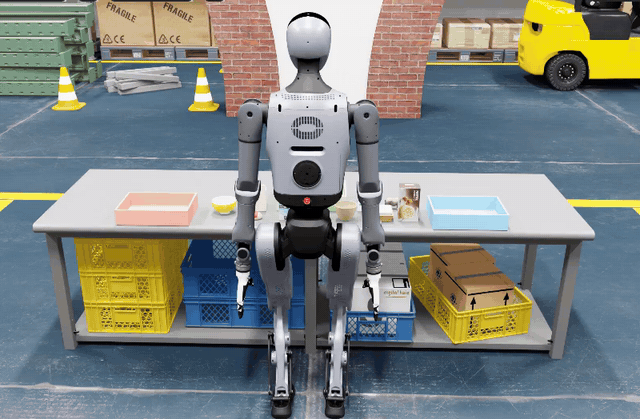

# Сортировка предметов гуманоидным роботом TienKung 2.0 Pro

Решение команды 049 для трека манипуляции хакатона **NSSR Polygon** (ноябрь 2026). Гуманоидный робот
TienKung 2.0 Pro в симуляторе NVIDIA Isaac Sim раскладывает предметы со стола по цветным ящикам. Робот управляется
узлами ROS 2 Humble.




*`sort3`, раскладка с сидом 7, ускорено в 15 раз: 3 предмета из 9 в своих ящиках, ни одного в чужом.
Полная запись без монтажа, с логами симулятора и решения:
[релиз demo-sort3-seed7](https://github.com/NoGuarantee/tienkung-sorting/releases/tag/demo-sort3-seed7).*

## Задача

- На столе 9 предметов трёх категорий: фигурки, посуда, коробки. Их нужно разложить по трём ящикам (красный, синий,
  зелёный), правило «категория → ящик» приходит в задании.
- Позы стола, ящиков и предметов не сообщаются. Решение видит сцену только через датчики робота: RGB-D камеры
  головы и торса, энкодеры суставов, `/tf`, состояние пальцев кистей Inspire.
- Ноги робота закреплены, корпус только поворачивается. Скорость моторов ограничена 0,8 рад/с.
- На раскладку даётся 405 с симуляционного времени. Решение вместе с симулятором должно уложиться в 16 ГБ VRAM и 32 ГБ RAM.
- Предмет в своём ящике даёт +10. Поднятый и не донесённый до ящика предмет стоит −10.

## Подход

Классический конвейер без обучаемой политики управления, три узла ROS 2:

```
RGB-D, /tf ──▶ perception ──▶ brain (state machine) ──▶ motion (cuRobo) ──▶ моторы и кисти
                   ▲                     │                       │
                   └──── повторный осмотр └──── /joint_states, датчики пальцев
```

- **Восприятие.** Облако точек из глубины в системе `pelvis`. Плоскость стола находится RANSAC, предметы выделяются
  кластеризацией, ориентация определяется по PCA. Предметы распознаются по размерам и цвету по каталогу, ящики по
  цветности. Трекер сохраняет номера предметов между осмотрами.
- **Движение.** Руки и корпус планирует NVIDIA cuRobo на GPU с учётом стола, ящиков и соседних предметов.
  Приводы недолетают до цели, поэтому траектория исполняется короткими отрезками с обратной связью по `/joint_states`.
  При переносе кисть удерживается ровно, чтобы предмет не выскользнул.
- **Миссия.** Конечный автомат на чистой функции `transition(context, event)`, без ROS и I/O, поэтому он
  тестируется без симулятора. Каждый шаг подтверждается датчиками: захват — по остановке пальцев и усилию, подъём —
  по TCP, укладка — повторным взглядом камеры. Ненадёжные предметы робот сознательно не трогает: нетронутый
  предмет стоит 0, а уроненный −10.
- **Записанные хваты.** Для части коробок используются профили хвата, записанные в симуляции. Они переводятся в
  координаты предмета, его позу даёт RGB-D модель.

## Результаты

На стенде (RTX 6000), `sort3`, пул 4: **3, 3 и 2 предмета из 9** на трёх раскладках, ни одного предмета в чужом
ящике. Главное ограничение — надёжность захвата пальцами: из девяти предметов стабильно удаётся брать три.
Пробирки (`tubes`) не решались.

## Команда

Denis Payunen, Vladislav, NoGuarantee.

Ниже — описание решения в том виде, в каком его сдавали на проверку.

---

## Статус

| Задача | Что делает решение |
|---|---|
| `sort3`, пул 4 | Brother и раковина обычным хватом, Philips записанным. RTX6000, `afe59fc`, сиды 7/13051/146: **3/9, 3/9, 2/9**, неверных лотков 0. Philips прошёл полный цикл 3/3. На 146 картридж Brother выпал на переносе (−10) |
| `sort2`, пул 4 | Тот же цикл с двумя ящиками. На стенде 2026-11-10, сиды 7, 13051, 146: 1, 1 и 0 объектов из 6 в своих ящиках |
| `sort2`, пул 6 (доп.) | Тот же цикл, захват по категории по умолчанию. На стенде, сид 7: 0 из 6 без штрафа, ничего не поднято |
| `tubes`, все варианты | Не решаем. Решение сразу публикует `/sim/task/done`, робот не двигается |

Ненадёжные объекты сознательно не трогаем: поднятый и не донесённый до ящика объект стоит −10, нетронутый 0.

План и распределение работ: [docs/ROADMAP.md](docs/ROADMAP.md).

По умолчанию включён записанный хват **только Philips**, при готовом RGB-D bundle.
Профили Brother, Nescafé и Rhino доступны для явной проверки, но не включены:
[источники, результаты и запуск](docs/RECORDED_SORT.md). Три проверенных сида
не доказывают надёжность на всех раскладках; `sort2` после включения Philips
не перепроверялся, его цифры в таблице относятся к прежнему режиму.
Отключение: `NSSR_RECORDED_GRASPS=false bash run.sh`.

## Как устроено решение

Конвейер из трёх узлов ROS 2, без обучаемой политики. Камера головы и глубина дают стол, ящики и объекты в системе
`pelvis`. Захват выбирается по таблице параметров объектов. Движения рук планирует cuRobo, а исполнение замыкается по
`/joint_states`. Почему так: [docs/ANALYSIS.md](docs/ANALYSIS.md). Узлы, интерфейсы и state machine:
[docs/ARCHITECTURE.md](docs/ARCHITECTURE.md).

| Узел | Роль |
|---|---|
| `hack_perception` | сервис `perception/perceive`: RGB-D → плоскость стола, ящики, объекты; последняя сцена в `perception/scene` |
| `hack_motion` | actions `motion/move_tcp`, `motion/move_joints`, `motion/hand`: cuRobo, исполнение по `/joint_states`, кисти |
| `hack_brain` | читает `/sim/task`, ведёт state machine миссии, проверяет каждый шаг по датчикам, публикует `/sim/task/done` |

Решение получает данные только от датчиков робота: камер, глубины, `/joint_states`, `/inspire_hand/state/*` и `/tf`.
Стол и ящики находятся камерой, заранее измеренных координат сцены в коде нет. Из топиков задачи используются
`/sim/task`, `/sim/objects/names` и `/clock`. Внутреннее состояние симулятора не используется.

### Сортировка (`sort2`, `sort3`)

**Детекция и положение объектов по глубине.** Голова наклонена на 0,4 рад. Кадр глубины переводится в облако точек
в `pelvis` по `/tf` на момент кадра. Плоскость стола находится RANSAC с уточнением методом наименьших квадратов.
Объекты — точки от 5 мм до 28 см над плоскостью, без точек у предплечий и кистей (по `/tf`). Точки собираются
в связные кластеры на сетке 5 мм. У каждого кластера есть центр, размеры, угол по главной оси (PCA) и высота верха.
Трекер сохраняет номера объектов между осмотрами.

**Распознавание.** Базовый кластер сравнивается по размерам и грубому цвету с каталогом объектов пула,
кандидаты берутся из `/sim/objects/names`. Для обычных хватов объекты с уверенностью ниже 0,6 и обрезанные краем кадра не берём.
Philips дополнительно проходит свежую каноническую проверку RGB-D модели перед подводом и спуском.

**Ящики.** Кластер размером с ящик относится к красному, синему или зелёному по цветности. Цвет сопоставляется с
ящиком через поле `trays` из `/sim/task`. Ящик, не попавший в кластеры, ищется по высоте борта и цвету. Если ящика
из задачи нет в кадре, голова один раз поворачивается к нему на 0,6 рад. Увиденный ящик запоминается на случай,
если позже его закроет рука.

**Захват.** Параметры объектов лежат в [grasp_db.yaml](src/hack_brain/config/grasp_db.yaml): тип хвата, высота, сила.
Картридж и раковина берутся пинчем сверху (указательный и большой палец). Рука выбирается по стороне ящика
назначения, для центрального ящика — по стороне объекта. Захват подтверждается по `/inspire_hand/state`: палец
остановился, не дойдя до цели, и вырос `effort`. Подъём подтверждается тем же и ростом TCP по `/tf`. Пока объект
несут, удержание проверяется постоянно, при потере миссия идёт к следующему объекту. При включённом Philips шесть объектов пула остаются
`skip`: носорог, божья коровка, мыльница, миска, Nescafe и чашка. Чашка
Ecoforms доехала в 2 случаях из 10, когда её подняли, а поднятый и не донесённый объект стоит −10, нетронутый 0.

**Движение.** cuRobo 0.8.0 планирует руки и поворот корпуса. В мире планировщика стол из плоскости perception,
ящики из камеры и соседние объекты как кубоиды. Подвод к объекту идёт планом по суставам, опускание и подъём по
прямой. Перенос идёт сначала вверх, затем к ящику ладонью вниз, чтобы объект не выпал. Приводы недолетают до цели,
поэтому путь исполняется короткими отрезками с проверкой по `/joint_states`. Если план мешает вторая рука, она
отводится в сторону и план строится снова.

**Раскладка.** Кончики пальцев опускаются на 10 см над ящиком, ближе к роботу от его центра, кисть раскрывается,
рука уходит в сторону. Затем голова снова смотрит на стол: объект засчитывается, только если камера видит его в
ящике назначения.

**Восстановление.** Цикл миссии: проверка пустых кистей → осмотр → подвод → опускание → хват → проверка →
подъём → проверка → перенос → проверка удержания → опускание → раскрытие → отход → проверка укладки. Если на
старте кисть не читается пустой (например, зажата с прошлой раскладки), обе кисти раскрываются и руки поднимаются.
Если одна кисть так и осталась зажатой, миссия продолжается второй рукой. Неподтверждённый подъём кончается
раскрытием кисти, и миссия продолжается. Каждый объект получает до двух попыток.

**Время и завершение.** Бюджет — 45 с времени симуляции на объект. Новый захват начинается, только если на него
осталось 40 с. Миссия заканчивается, когда брать больше нечего или вышло время. `/sim/task/done` публикуется в
любом исходе: при обычном конце, при исключении в миссии, при падении конструктора узла и при остановке `/clock`.

### Пробирки (`tubes`)

Не решаем. В state machine есть общий цикл для штативов, но нет навыков переноса в шкаф, вставки и переворота.
Решение видит, что нужных навыков нет, и сразу публикует `/sim/task/done`. Робот не двигается.

### Модели и библиотеки

- Планирование движений: cuRobo 0.8.0 (NVIDIA), torch 2.8.0 с CUDA 12.8, warp-lang. Ставятся в
  [setup.sh](setup.sh) через [tools/curobo_install.sh](tools/curobo_install.sh), там же прогреваются ядра.
- Perception: numpy и RGB-D модели из проверяемого bundle в репозитории.
- rclpy, tf2_ros, PyYAML, `bodyctrl_msgs` из образа симулятора.

RGB-D воркер работает по запросу для Philips; остальные поверхности остаются препятствиями.
`setup.sh` по умолчанию готовит bundle из `assets/perception/` и проверяет загрузку на CPU.
При ошибке подготовки `run.sh` возвращается к обычной сортировке. Явное
`NSSR_RECORDED_GRASPS=false` выключает и установку RGB-D в setup, и worker при запуске.

## Запуск

Так решение ставится и запускается на итоговой проверке (`hackathon/tools/solution.sh` симулятора):

```bash
cd /solution
bash setup.sh          # cuRobo и torch, несколько минут
source /opt/ros/humble/setup.bash && colcon build
source install/setup.bash && bash run.sh
```

`run.sh` запускает [solution.launch.py](src/hack_bringup/launch/solution.launch.py): три узла с `use_sim_time`.
Когда `hack_brain` публикует `done` и выходит, launch завершается.

Проверить у себя, при запущенном симуляторе, из репозитория симулятора:

```bash
bash hackathon/tools/task.sh sort3 --pool 4
bash hackathon/tools/solution.sh ~/путь/к/nssr-sol-team-049      # во втором терминале
```

Команда работает на общем GPU-сервере через `tools/remote.sh`: [docs/SERVER.md](docs/SERVER.md). Цикл
разработки, ветки и правила: [CONTRIBUTING.md](CONTRIBUTING.md).

## Структура

```
src/
  hack_interfaces/   msg / srv / action, общие для узлов
  hack_motion/       cuRobo, движения суставов, кисти
  hack_perception/   камеры, глубина, стол, ящики, объекты
  hack_brain/        state machine, skills, планировщик захватов, config/grasp_db.yaml
  hack_bringup/      launch-файл
tools/
  check_rules.sh     нет ли в src/ запрещённых обращений (отладочные топики, внутренности симулятора)
  remote.sh          GPU-стенд: симулятор, решение, логи
  pick_one.py, *_probe.py, *_check.py   отладочные пробы на стенде
docs/
  ANALYSIS.md        разбор задач, баллов, правил и выбор подхода
  ARCHITECTURE.md    узлы, интерфейсы, state machine, отладка модулей
  ROADMAP.md         вехи, статус и результаты прогонов
run.sh               запуск решения
setup.sh             установка cuRobo и torch
```

## Скринкасты

Прикладываются к Releases этого репозитория: по одному на каждую задачу и вариант, которые решаем (`sort3` и
`sort2` на пуле 4). На записи окно симулятора от старта до `done` и терминал со строкой `layout seed`.

## Проверка без симулятора

```bash
PYTHONPATH=src/hack_brain:src/hack_motion:src/hack_perception:tests python3 -m unittest discover -s tests -v
python3 tools/fake_mission.py
bash tools/check_rules.sh
```

Fake-прогон проверяет управление state machine, а не физический захват. Спецификация и таблицы переходов:
[docs/FSM_SPEC.md](docs/FSM_SPEC.md), проверки: [docs/FSM_VALIDATION.md](docs/FSM_VALIDATION.md).

## Лицензия

Код распространяется по лицензии Apache 2.0, см. [LICENSE](LICENSE). Модель робота
[tiangong2pro_with_hands.urdf](src/hack_motion/robot/tiangong2pro_with_hands.urdf) — TienKung 2.0 Pro от UBTECH
Robotics (UBT Sim, Apache License 2.0), взята из симулятора организаторов хакатона.
