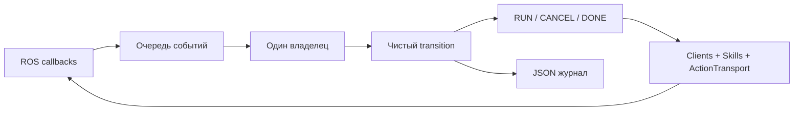

# Архитектура решения

Три ROS 2 процесса: perception → brain → motion. Общие ROS msg/srv/action в `hack_interfaces`
сохранены без изменений. Все координаты — pelvis, единицы СИ, время задачи — `/clock`.

## Исполнение миссии

`brain_node.py` запускает один поток-владелец контекста. ROS callbacks только ставят события в очередь.
Перед обработкой события владелец подаёт актуальный TICK, затем вызывает чистую функцию
`transition(context, event) -> new_context, effects`. CANCEL/ERROR/CONNECTION_LOST имеют высший приоритет в очереди; внутри приоритета сохраняется FIFO.
Длительные запросы отправляются один раз эффектом RUN. Future callbacks не блокируются.

| Файл hack_brain | Ответственность |
|---|---|
| `context.py` | Enum/dataclass: фаза, рука, история подъёма, операции, наблюдения, доказательства |
| `fsm.py` | общий цикл, проверки, recovery, отмена и завершение; без ROS, sleep и I/O |
| `policies.py` | capabilities, выбор предметов и контейнеров, правила всех вариантов |
| `verification.py` | свежесть и соответствие доказательств текущей цели |
| `task.py` | JSON задания, бюджет, маршрутизация штативов |
| `skills.py` | `command`: перевод фаз сортировки в Hand/MoveTcp goals, без второго mission loop. `pick`/`place`/`ready`: блокирующие последовательности с запасными путями со стенда, для `tools/pick_one.py`; в FSM их пока нет |
| `blocking.py` | `BlockingClients`: блокирующие обёртки perception и motion для `Skills.pick/place` и `tools/` |
| `grasp_planner.py` | существующие геометрические кандидаты захвата и укладки, параметры не откалиброваны |
| `clients.py` | ROS services/actions, преобразование SceneObjects, честный UNKNOWN для отсутствующего verifier |
| `transport.py` | goal handle, отказ, асинхронный результат, позднее принятие, cancel и владение ресурсом |
| `brain_node.py` | подписки, очередь, часы, журнал, исполнение эффектов, попытки done |

Подробные состояния и нормативные таблицы: [FSM_SPEC.md](FSM_SPEC.md).
CHECK и SELECT в спецификации — локальные решения, не ожидающие внешних событий.
Составные pick/place представлены фазами общего автомата. INSERT/REORIENT — точки подключения
составных навыков команды; внутреннее контактное управление здесь не реализуется.



## Ресурсы и физическое состояние

Первая версия последовательная: одна операция на весь робот, включая read-only запросы.
ACCEPTED — только подтверждение приёма. Все результаты коррелируются по operation_id.
Таймаут запускает cancel и не снимает active. Cancel ACK и терминальный результат требуются отдельно;
`stopped` — дополнительное подтверждение физической остановки. При отказе или истечении ожидания
сохраняется blocked, затем done. Продолжения после отмены в этой версии нет.

Проверен исходный `motion_node.py`: cancel_callback не задан, запросы отмены не обрабатываются в цикле,
позиционные цели могут продолжать действовать после возврата ошибки. Сервер не изменён:
без проверенного способа остановки добавлять формальный успешный cancel было бы неверно.
Реальный ActionTransport никогда не выдаёт stopped=True из одного ROS terminal status.
Терминальная ошибка реального движения поэтому завершает миссию с блокировкой; fake умеет отдельно
моделировать подтверждённую остановку и проверяет recovery.

EMPTY/HOLDING/UNKNOWN отделены от NEVER_LIFTED/LIFTED/UNKNOWN и confirmed placement.
После контакта сцена инвалидируется. После подъёма назначение переснимается; перед переносом снова
проверяется удержание. SENSOR может прервать активную операцию при потере/неопределённости удержания.
Отсутствие verifier не превращается в EMPTY. Имена распознанных объектов сохраняют историю;
track_id не считается гарантией идентичности после контакта. Анонимная цель после контакта не
перезахватывается без нового контракта tracking. Позиционные ключи удалены.

## Текущее состояние и подключение команды

| Компонент | Реализовано | Что ещё нужно |
|---|---|---|
| brain | цикл всех финальных задач, маршрутизация, проверки, повторы, таймер, отмена, done | ROS integration и физическая проверка |
| perception | геометрия облака, детекция предметов и ящиков | синхронизация RGB/depth, свежие позы контейнеров/гнёзд, tracking |
| motion | joint/hand actions, cuRobo direct/linear, отмена и измеренное удержание | физическая проверка отмены, контроль силы |
| verification | измерительные проверки кисти/TF/RGB-D, окно покоя | физическая калибровка, пробирки |
| tubes skills | общие фазы/guards и fake routing | реальные hood-transfer, insert, reorient и их подтверждения |

`Brain.mission_context` хранит состояние FSM, `Brain.adapters` — адаптеры; имена `context`/`clients`
зарезервированы базовым ROS Node. `Clients.capabilities` включает sorting verification. `Measurements` читает `/joint_states` и состояния кистей,
`PhysicalVerifier` — контакт, TF подъёма и свежую именную детекцию в ящике. Данные UNKNOWN не становятся успехом.
`ActionTransport` ждёт измеренного покоя после terminal результата, включая успешные actions.
Motion обрабатывает cancel и прекращает выдачу новых целей; стоп проверяет клиент независимо от ACK.
Подробные критерии, ограничения и команды проверки: [FSM_VALIDATION.md](FSM_VALIDATION.md).
Tube capabilities отсутствуют: существующие интерфейсы не менялись, вставка и детекция штативов не реализованы.

## Сцена и кисти

- Стол, ящики, штативы и шкаф находятся камерами, как объекты. Заранее измеренные позы сцены в код не зашиваем;
  можно границы поиска, размеры из документации, состав ящиков из `/sim/task` и геометрию робота.
  Мир cuRobo `motion` собирает из `perception/scene` (латч, после каждого удачного `perceive`): плиту под плоскостью
  `SceneObjects.table_plane` на границах поиска стола и ящики из `containers`, которые есть в `/sim/task`. Спрятанный
  за рукой ящик остаётся на последнем месте. До первого `perceive` `MoveTcp` отказывает: стола в мире ещё нет.
  Куда класть предмет, `brain` берёт из `scene.containers`.
- `Hand.force` вызывает `/inspire_hand/set_force`, рабочий диапазон 0.3–0.5: полная сила выталкивает объект. Сжатие —
  чуть за объект, скорость через `/inspire_hand/set_speed`, сначала поворот большого пальца.

## Время и журнал

Deadline = первый доступный brain simulation timestamp + n_items × 45/60 секунд.
По записанному ответу организаторов симулятор между раскладками не перезапускается.
Запас reserve=10 секунд покрывает запуск до первого clock и завершение; ожидание TaskSpec бюджет не обновляет.
Перед новым захватом нужен cycle_estimate + reserve; с предметом в руке приоритет доставка до
жёсткой границы deadline − reserve. Monotonic время используется только для watchdog и cancel.
Начальные значения параметров перечислены в Config и экспонированы как ROS параметры; их нужно измерить
в симуляторе. Неизвестный clock, его остановка и скачок назад завершают миссию.

JSON строки brain содержат event, operation_id, from/to, target, attempt, hand, lift, scene_stamp,
operation_elapsed_sim, remaining_sim, reason и blocked. Старые id видны в журнале, но не продвигают
операцию. DONE не равен успешной миссии; подтверждения хранятся по каждому объекту.
При потере ROS-контекста CONNECTION_LOST отмечает активный ресурс blocked и делает попытки done;
доставка сообщения без действующего middleware не гарантируется.

## Проверка и расширение

Из корня репозитория, без ROS и сторонних Python-пакетов:

```bash
PYTHONPATH=src/hack_brain:tests python3 -m unittest discover -s tests -v
python3 tools/fake_mission.py
python3 tools/fake_mission.py --variant lying
bash tools/check_rules.sh
```

Fake находится только в tests/tools и никогда не подключается runtime launch-файлом.
Тесты границы Brain используют ROS-shaped заглушки; это не интеграционный тест DDS/rclpy.

Новый вариант, если достаточно имеющихся фаз: расширить required_capabilities/destinations,
описать правило в TaskSpec, добавить сценарии успеха, отсутствия навыка и неверного назначения.
Новый навык: определить capability и вход/выход, добавить фазу/проверку в FSM_SPEC и State,
перевести effect в команду адаптера, покрыть отказ, timeout, late result, cancel и UNKNOWN.
Сначала проверить fake, затем ROS lifecycle, затем физическое выполнение. Не добавлять второй цикл
управления миссией внутрь Skills.
