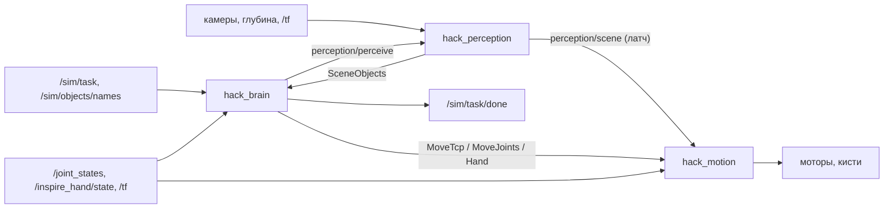

# Архитектура решения

Три ROS 2 узла из `hack_bringup/launch/solution.launch.py`: perception, brain, motion. Обучаемой политики нет.
Общие msg/srv/action лежат в `hack_interfaces`. Все координаты — `pelvis`, единицы СИ, время задачи — `/clock`.



Brain владеет миссией и единственный публикует `/sim/task/done`. Если brain завершился, launch гасит остальные узлы.

## perception

Сервис `perception/perceive` (`Perceive.srv`: камера `head|torso`, область `table`). Узел хранит последние цветной
кадр, глубину и camera_info обеих камер и считает сцену только по запросу: CPU учитывается при равенстве баллов.
Каждая удачная сцена ещё публикуется в латч-топик `perception/scene`.

| Файл hack_perception | Ответственность |
|---|---|
| `perception_node.py` | кадры, облако в `pelvis` по `/tf` на момент кадра, вырезание рук, сборка `SceneObjects`, трекер |
| `table_clusters.py` | RANSAC плоскость стола, точки над ней, связные кластеры на сетке, центр, размер, yaw (PCA), верх |
| `classify.py` | ящик по цвету (красный, синий, зелёный), объект по размеру и грубому цвету среди `/sim/objects/names` |
| `tray_rims.py` | ящик, не выделенный кластером, по высоте борта и цвету |
| `rgbd/`, `rgbd_service.py` | нейросетевые позы объектов в отдельном процессе; выключены (`rgbd_enable_model_poses=false`) |

Нейросети в рабочем пути нет. Уверенность объекта ниже порога brain не берёт. Область `hood` и штативы не
реализованы.

## brain

`brain_node.py` запускает один поток-владелец контекста. ROS callbacks только ставят события в очередь.
Перед обработкой события владелец подаёт актуальный TICK, затем вызывает чистую функцию
`transition(context, event) -> new_context, effects`. CANCEL/ERROR/CONNECTION_LOST имеют высший приоритет в очереди;
внутри приоритета сохраняется FIFO. Длительные запросы отправляются один раз эффектом RUN. Future callbacks не
блокируются.

| Файл hack_brain | Ответственность |
|---|---|
| `context.py` | Enum/dataclass: фаза, рука, история подъёма, операции, наблюдения, доказательства, Config |
| `fsm.py` | общий цикл, проверки, recovery, отмена и завершение; без ROS, sleep и I/O |
| `policies.py` | capabilities, выбор предметов и ящиков, правила вариантов, `skip` и число попыток |
| `task.py` | JSON задания, бюджет, маршрутизация штативов |
| `sensors.py` | измерения с временем: суставы, пальцы, усилия; успех action не считается физическим фактом |
| `physical.py` | доказательства: удержание, подъём, объект в ящике; заслонённое остаётся UNKNOWN |
| `verification.py` | свежесть и соответствие доказательств текущей цели |
| `grasp_planner.py` | позы захвата и укладки по детекции и `config/grasp_db.yaml` (хват, высота, сила, `skip`) |
| `skills.py` | `command`: фаза FSM → одна цель Hand/MoveTcp. `pick`/`place`/`ready`: блокирующие последовательности для `tools/pick_one.py`, в FSM их нет |
| `blocking.py` | `BlockingClients`: блокирующие обёртки perception и motion для `Skills.pick/place` и `tools/` |
| `clients.py` | ROS services/actions, преобразование SceneObjects, слежение за удержанием во время операции |
| `transport.py` | goal handle, отказ, асинхронный результат, позднее принятие, cancel и владение ресурсом |
| `brain_node.py` | подписки, очередь, часы, журнал, исполнение эффектов, попытки done |

Цикл сортировки:

```
VERIFY_EMPTY → [CLEAR] → LOOK_TABLE → OBSERVE → OPEN → APPROACH → DESCEND → CLOSE → VERIFY_GRASP
  → LIFT → VERIFY_LIFT → DESTINATION → VERIFY_TRANSFER → TRANSFER → VERIFY_HOLD → LOWER → RELEASE
  → RETREAT → VERIFY_PLACE → VERIFY_EMPTY …
```

- Старт: если VERIFY_EMPTY читает кисть не пустой (зажата с прошлой раскладки), OPEN_HANDS раскрывает обе кисти,
  LOOK_TABLE даёт motion плоскость стола, ARMS_READY поднимает руки. Кисть, оставшаяся зажатой, выключает свою руку.
- CLEAR перед осмотром отводит руку прошлого захвата из кадра. LOOK_TABLE один раз поворачивает голову к боковому
  ящику из задачи, которого ещё не видели.
- Неудача после касания идёт в RECOVER. Пустая кисть низко над столом — BACK_OFF вверх и новый осмотр.
  Неподтверждённый подъём кончается раскрытием кисти, миссия идёт к следующему объекту. На объект до
  `max_attempts` попыток.
- `REORIENT`/`INSERT` и capabilities `insert`, `hood`, `reorient` — точки подключения для пробирок. Их нет,
  поэтому на `tubes` миссия сразу завершается публикацией done.

Подробные состояния и нормативные таблицы: [FSM_SPEC.md](FSM_SPEC.md), руководство: [FSM_GUIDE.md](FSM_GUIDE.md).

## motion

Три action в `motion_node.py`. Номера моторов, пределы и группы в `robot.py`.

- `MoveJoints`: синхронный приход суставов, контур замкнут по `/joint_states` против недолёта PD.
- `Hand`: пресеты кисти (`open`, `power`, `pinch`, …), сила через `/inspire_hand/set_force`, скорость через
  `/inspire_hand/set_speed`, большой палец первым. Результат `object_detected`: палец остановился раньше цели
  с усилием выше порога.
- `MoveTcp` через cuRobo (`curobo_planner.py`): поворот корпуса и обе руки, вторая рука держит текущую позу.
  Режимы `direct` (IK и план по суставам), `linear` (прямая в декартовом пространстве), `ready` (рука в сторону,
  вне кадра головы), `carry` (с объектом: вверх, затем поперёк; `direct`, если отрезок не строится). Траектория
  исполняется короткими отрезками по `/joint_states`. Ошибка в результате — по TF TCP, а не по суставам. Если план
  мешает вторая рука, она уходит в `ready`, и план строится снова.

Мир cuRobo собирается из `perception/scene`: плита под `table_plane`, ящики задачи из `containers`, соседние объекты
кубоидами. Спрятанный за рукой ящик остаётся на последнем месте. До первого `perceive` с плоскостью стола `MoveTcp`
отказывает. Компиляция ядер кешируется в `setup.sh` (`tools/curobo_warmup.py`), планировщик строится, пока brain
осматривает сцену.

## Ресурсы и физическое состояние

Версия последовательная: одна операция на весь робот, включая read-only запросы.
ACCEPTED — только подтверждение приёма. Все результаты коррелируются по operation_id.
Таймаут запускает cancel и не снимает active. Cancel ACK и терминальный результат требуются отдельно;
`stopped` — отдельное подтверждение физической остановки. Motion принимает cancel и прекращает выдачу новых целей,
но остановку `ActionTransport` проверяет сам: после терминального результата, включая успешный, он ждёт измеренного
покоя. Один ROS terminal status никогда не даёт stopped=True. При отказе или истечении ожидания сохраняется blocked,
затем done. Продолжения после отмены нет.

EMPTY/HOLDING/UNKNOWN отделены от NEVER_LIFTED/LIFTED/UNKNOWN и confirmed placement. Удержание: палец остановился,
не дойдя до цели, с усилием. Подъём: удержание без перерыва и рост TCP по `/tf`. Укладка: единственная именная
детекция в ящике назначения после раскрытия и отхода. Данные UNKNOWN не становятся успехом.
После контакта сцена инвалидируется. После подъёма назначение переснимается; перед переносом снова проверяется
удержание. SENSOR прерывает активную операцию при потере удержания. Имена распознанных объектов сохраняют историю;
track_id не считается гарантией идентичности после контакта. Анонимная цель после контакта не перезахватывается.

## Сцена и кисти

- Стол, ящики, штативы и шкаф находятся камерами, как объекты. Заранее измеренные позы сцены в код не зашиваем;
  можно границы поиска, размеры из документации, состав ящиков из `/sim/task` и геометрию робота. Куда класть
  предмет, brain берёт из `scene.containers`.
- Сила хвата задаётся на объект в `grasp_db.yaml`: полная сила выталкивает объект. Сжатие — чуть за объект.
  Объекты, которые на стенде не доезжают до ящика, помечены `skip`: поднятый и не донесённый объект стоит −10,
  нетронутый 0.

## Время и журнал

Deadline = первый доступный brain simulation timestamp + n_items × 45/60 секунд.
По записанному ответу организаторов симулятор между раскладками не перезапускается.
Запас reserve=10 секунд покрывает запуск до первого clock и завершение; ожидание TaskSpec бюджет не обновляет.
Перед новым захватом нужен cycle_estimate + reserve; с предметом в руке приоритет доставка до
жёсткой границы deadline − reserve. Monotonic время используется только для watchdog и cancel.
Параметры перечислены в Config и экспонированы как ROS параметры. Неизвестный clock, его остановка и скачок назад
завершают миссию.

JSON строки brain содержат event, operation_id, from/to, target, attempt, hand, lift, scene_stamp,
operation_elapsed_sim, remaining_sim, reason и blocked. Старые id видны в журнале, но не продвигают
операцию. DONE не равен успешной миссии; подтверждения хранятся по каждому объекту.
При потере ROS-контекста CONNECTION_LOST отмечает активный ресурс blocked и делает попытки done.

## Текущее состояние

| Компонент | Работает на стенде | Нет или слабо |
|---|---|---|
| perception | стол, кластеры, ящики по цвету, объекты по размеру и цвету, трекер | нейросетевые позы выключены, штативы и hood |
| brain | полный цикл сортировки, проверки датчиками, recovery, бюджет, done в любом исходе | пробирки: только точки подключения |
| motion | joint/hand/TCP actions, мир из perception, перенос `carry`, отмена | контроль силы при переносе |
| захват | картридж и раковина пинчем сверху | остальные объекты пула 4 в `skip`: выскальзывают |

Цифры прогонов и план: [ROADMAP.md](ROADMAP.md). Критерии проверок FSM: [FSM_VALIDATION.md](FSM_VALIDATION.md).

## Проверка и расширение

Из корня репозитория, без ROS и сторонних Python-пакетов:

```bash
PYTHONPATH=src/hack_brain:tests python3 -m unittest discover -s tests -v
python3 tools/fake_mission.py
python3 tools/fake_mission.py --variant lying
bash tools/check_rules.sh
```

Fake находится только в tests/tools и никогда не подключается runtime launch-файлом.
Тесты границы Brain используют ROS-shaped заглушки; это не интеграционный тест DDS/rclpy.
Отдельный захват на стенде: `tools/pick_one.py` (в том числе `--sweep`).

Новый вариант, если достаточно имеющихся фаз: расширить required_capabilities/destinations,
описать правило в TaskSpec, добавить сценарии успеха, отсутствия навыка и неверного назначения.
Новый навык: определить capability и вход/выход, добавить фазу/проверку в FSM_SPEC и State,
перевести effect в команду адаптера, покрыть отказ, timeout, late result, cancel и UNKNOWN.
Сначала проверить fake, затем ROS lifecycle, затем физическое выполнение. Не добавлять второй цикл
управления миссией внутрь Skills.
