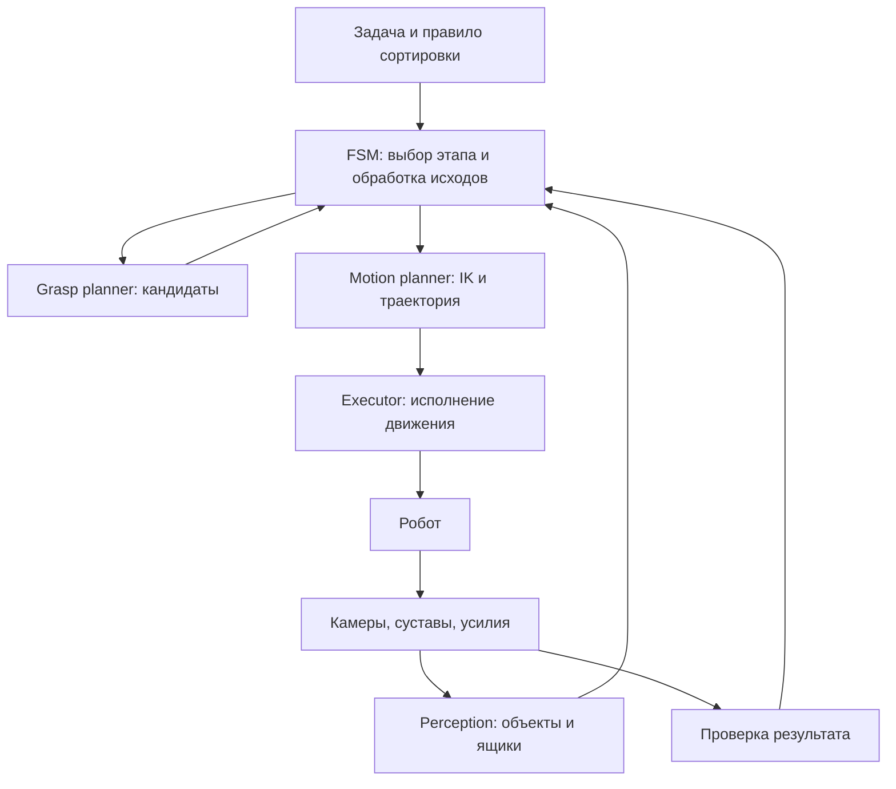
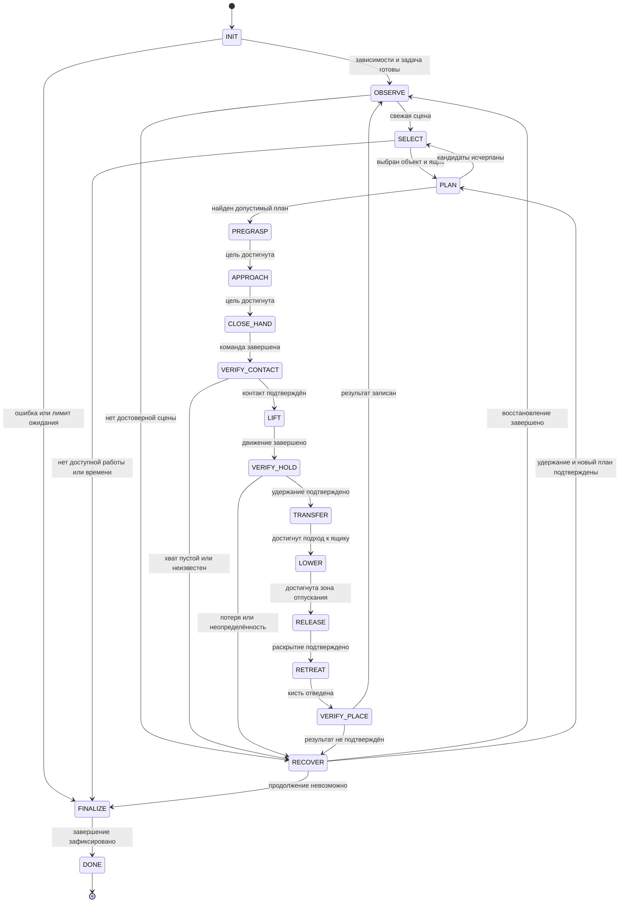

> Обновление реализации: нормативная спецификация теперь в [FSM_SPEC.md](FSM_SPEC.md),
> фактическая структура — в [ARCHITECTURE.md](ARCHITECTURE.md). Ниже сохранён исходный учебный
> документ и проектные предложения. Описания старого Clients._action, Skills.pick/place,
> brain_node.run_sort/run_tubes и их недостатков относятся к исходному каркасу: эти циклы заменены
> единым event-driven FSM. Реальные навыки и физические подтверждения по-прежнему недоступны;
> fake-проверки не доказывают выполнение в симуляторе.

# Конечный автомат в робототехнике: от идеи до исполнительного слоя для команды 049

Дата: 2 ноября 2026 года. Контекст: ветка `denis`, исходный код решения `f2e32f4`, симулятор `7447469`.

Документ объясняет принципы и предлагает проектирование FSM для нашего решения. Предложенные состояния, структуры и интерфейсы ниже ещё не реализованы. Под «фронтиром» понимаются современные системы embodied AI: VLA, языковые планировщики, обучаемые навыки и их надёжное исполнение.

## Содержание

1. [Зачем роботу конечный автомат](#1-зачем-роботу-конечный-автомат)
2. [Из чего состоит автомат](#2-из-чего-состоит-автомат)
3. [Где он находится в архитектуре](#3-где-он-находится-в-архитектуре)
4. [Как проектировать состояния](#4-как-проектировать-состояния)
5. [Автомат для нашего робота](#5-автомат-для-нашего-робота)
6. [Неопределённость и проверка результата](#6-неопределённость-и-проверка-результата)
7. [ROS 2, асинхронность и отмена](#7-ros-2-асинхронность-и-отмена)
8. [Время, бюджет и завершение](#8-время-бюджет-и-завершение)
9. [Как организовать код](#9-как-организовать-код)
10. [Как проверять автомат](#10-как-проверять-автомат)
11. [FSM, behavior tree и планирование](#11-fsm-behavior-tree-и-планирование)
12. [Роль FSM во фронтирной робототехнике](#12-роль-fsm-во-фронтирной-робототехнике)
13. [Что делать в нашем репозитории](#13-что-делать-в-нашем-репозитории)
14. [Источники](#14-источники)

## 1. Зачем роботу конечный автомат

Представим задачу: взять чашку со стола и положить её в синий ящик.

На бумаге достаточно пяти команд:

```text
подойти кистью → закрыть пальцы → поднять → перенести → раскрыть
```

В физическом мире каждая стрелка требует ответа: что произошло на самом деле?

- Рука могла не достичь цели.
- Пальцы могли сомкнуться в воздухе.
- Предмет мог выскользнуть после подъёма.
- Детектор мог перепутать ящик.
- Связь могла оборваться во время движения.
- Время задачи могло закончиться, пока предмет ещё в руке.

Последовательный скрипт легко описывает удачную попытку. Конечный автомат делает явными допустимые этапы, события перехода и действия при отклонении от ожидаемого результата.

**FSM отвечает: «В каком этапе выполнения мы находимся и что разрешено делать дальше?»**

Он нужен для четырёх вещей:

1. **Управление порядком:** переносить предмет можно после подтверждённого захвата.
2. **Реакция на результат:** при недостижимости сменить кандидат, при потере предмета переснять стол.
3. **Наблюдаемость:** по журналу понятно, где и почему остановилась задача.
4. **Проверяемость:** можно независимо проверить, что автомат не начинает второе движение, пока первое не завершено.

Само наличие FSM не гарантирует безопасность или успешность. Он гарантирует только те свойства, которые действительно заложены в переходы, проверяются корректными сигналами и поддерживаются исполнителями.

## 2. Из чего состоит автомат

### 2.1 Состояния, события, переходы

В простом представлении:

```text
следующее состояние = transition(текущее состояние, событие)
```

Пример:

```text
состояние: APPROACH
событие: движение завершилось успешно
переход: APPROACH → CLOSE_HAND
```

В реальном роботе решение зависит ещё от данных. Например, после ошибки подхода можно повторить попытку, только если остались кандидаты и время. Поэтому обычно используют **расширенный конечный автомат — EFSM**:

```text
transition(state, event, context) → new_state, updated_context, effects
```

Количество управляющих состояний конечно. Контекст может содержать численные координаты, время, счётчики и оценку мира. Формально такая модель уже богаче простого конечного автомата; это нормальная инженерная практика.

| Элемент | Смысл | Пример |
|---|---|---|
| State | Текущая фаза исполнения | `VERIFY_GRASP` |
| Event | Что произошло | `GRASP_CONFIRMED` |
| Guard | Условие разрешения перехода | Есть свежие датчики и запас времени |
| Effect | Однократное внешнее действие | Отправить цель подъёма |
| Context | Память задачи | Объект, рука, кандидат, попытки, дедлайн |
| Invariant | Свойство, обязательное всегда | Не более одной команды владельцу руки |

**Событие и условие различаются.** «Пришёл новый кадр» — событие. «Кадр свежий и содержит нужный ящик» — условие.

### 2.2 Состояние исполнения и состояние мира

Эти две вещи нельзя смешивать:

```text
execution_state = VERIFY_GRASP
belief.holding = UNKNOWN
belief.target_visible = True
```

Первое говорит, что делает программа. Второе — что она предполагает о физическом мире по датчикам. Переход в `CLOSE_HAND` не означает, что объект уже удерживается.

### 2.3 Вход, работа, выход

Полезная дисциплина для длительного состояния:

- `on_enter`: отправить команду один раз, сохранить идентификатор и время начала.
- `on_event` / `tick`: обработать результат, новые наблюдения и таймауты.
- `on_exit`: освободить ресурсы либо начать согласованную отмену.

Нельзя повторно отправлять ту же цель на каждом тике просто потому, что автомат всё ещё в `APPROACH`: сервер получит множество конкурирующих задач.

## 3. Где он находится в архитектуре



У каждого уровня своя ответственность:

| Уровень | На какой вопрос отвечает |
|---|---|
| Task planner / selector | Какой объект и куда переносить следующим? |
| FSM / executive | Можно ли начать этап, чем он закончился, как восстановиться? |
| Grasp planner | Где и как расположить кисть относительно предмета? |
| Motion planner | Каким путём попасть туда без столкновений в модели сцены? |
| Controller / executor | Как следовать пути с учётом измеренного движения? |
| Perception / estimator | Где предметы и что изменилось? |

FSM не должен вычислять Якобиан, сегментировать изображение или крутить ПД-регулятор. Он вызывает компоненты с понятными контрактами.

Для нашего робота это соответствует пакетам `hack_brain`, `hack_perception`, `hack_motion`. Кандидаты и составные навыки сейчас находятся внутри `hack_brain`.

Робот сочетает дискретные режимы и непрерывную динамику: переход `APPROACH → CLOSE_HAND` дискретен, координаты руки меняются непрерывно. Это естественно рассматривать как гибридную систему. Однако для нашей задачи не нужно моделировать всю динамику внутри FSM: достаточно делегировать её motion и контролировать условия переходов.

## 4. Как проектировать состояния

### 4.1 Начать с контракта задачи

До рисования стрелок надо выписать:

- Что считается успехом?
- По каким наблюдениям можно его подтвердить?
- Какие действия необратимо меняют положение вещей?
- Какие ресурсы ограничены?
- Как завершаться при частичном успехе?

У нас успех — предмет в назначенном ящике. Команда раскрытия пальцев сама по себе не доказывает успех. После подъёма предмет нельзя просто забыть: по записанному в `ANALYSIS.md` уточнению организаторов поднятый предмет вне правильного ящика даёт штраф.

### 4.2 Сначала удачный путь, затем все выходы

Для каждой фазы заполнить шесть полей:

```text
1. Предусловия
2. Команда на входе
3. Наблюдаемое подтверждение успеха
4. Ошибки
5. Таймаут
6. Восстановление
```

Пример для `LIFT`:

| Поле | Предлагаемый контракт |
|---|---|
| Предусловия | Контакт подтверждён, путь подъёма допустим, цель актуальна |
| Команда | Поднять TCP по траектории, сохраняя хват |
| Успех | Движение завершено; затем отдельная проверка удержания |
| Ошибки | Потеря предмета, движение не выполнено, датчики устарели |
| Таймаут | Отмена движения и ожидание подтверждённого прекращения |
| Восстановление | При удержании — перепланировать; при потере — повторно наблюдать сцену |

### 4.3 Выбирать правильную гранулярность

Слишком крупно:

```text
PICK → PLACE
```

Так можно оставить внешний интерфейс, но внутри `PICK` всё равно нужен разбор фаз и ошибок.

Слишком мелко: отдельное состояние для каждого кадра, сустава или waypoint. Это раздувает граф и связывает brain с деталями контроллера.

Хорошее состояние — этап с отдельным ожидаемым результатом и особой реакцией на ошибку. `VERIFY_GRASP` полезно выделить, потому что его неуспех требует другого решения, чем недостижимость `PREGRASP`.

### 4.4 Использовать иерархию

Верхний уровень:

```text
INITIALIZING → SORTING / TUBES / UNSUPPORTED → FINALIZING → DONE
```

Внутри `SORTING` — цикл выбора и переноса. Внутри `PICK` — подход, закрытие, проверка, подъём. Общие реакции на потерю связи можно вынести на уровень родителя.

Так повторная проверка датчиков не копируется в двадцать веток. При этом надо явно задать приоритет событий: например, потеря связи или запрос остановки важнее обычного успешного результата.

## 5. Автомат для нашего робота

Ниже — предлагаемая схема для первой реализации сортировки, а не описание существующего кода.



На схеме опущены глобальные переходы при ошибках движения. Из любого состояния с активной командой при прерывании сначала выполняется протокол отмены; переход к новому движению разрешён только после его завершения.

### 5.1 Таблица основных решений

| Состояние | Успех | Неуспех |
|---|---|---|
| `INIT` | Есть задача, время, свежие состояния, сервисы | Ограниченное ожидание; корректное завершение |
| `OBSERVE` | Согласованная сцена в `pelvis` | Новый кадр или другой ракурс с лимитом попыток |
| `SELECT` | Есть объект, целевой ящик и бюджет | Завершение или повторное наблюдение по причине |
| `PLAN` | Достижим захват и оценён перенос | Другой кандидат, рука или объект |
| `PREGRASP` | Рука у предзахвата | Отмена; повторный план с текущей конфигурации |
| `APPROACH` | Кисть у предмета | Контролируемый отход, если он допустим |
| `VERIFY_CONTACT` | Есть признаки контакта | Раскрыть и отойти только при подтверждённо допустимом состоянии |
| `VERIFY_HOLD` | После подъёма предмет удерживается | Оценить, где предмет; не продолжать перенос вслепую |
| `TRANSFER` | Предмет доставлен над нужным ящиком | Сохранять хват, отменить движение, перепланировать |
| `RELEASE` | Кисть раскрыта | Не считать укладку успешной; проверить датчики |
| `VERIFY_PLACE` | Есть достаточные признаки укладки | Повторно наблюдать и определить дальнейшие действия |

### 5.2 Контекст миссии

Контекст можно представить так:

```text
MissionContext
  task_spec
  deadline_sim
  target_object_id
  target_container_id
  selected_arm
  grasp_candidate_index
  scene_stamp
  holding: EMPTY | HOLDING | UNKNOWN
  lift_history: NEVER_LIFTED | LIFTED | UNKNOWN
  active_operation_id
  attempt_counters
  object_history
  termination_reason
```

`holding` и история подъёма независимы. Предмет может уже лежать на столе, но до этого быть поднятым. Приоритет его повторного захвата отличается от приоритета нетронутого предмета.

Эта история — оценка по доступным сигналам, а не доступ к внутреннему счётчику судьи. Если подъём не удалось достоверно установить, надо хранить `UNKNOWN`.

### 5.3 Восстановление — тоже поведение

Одного состояния `ERROR` недостаточно. Минимально нужны разные стратегии:

| Ситуация | Что делать |
|---|---|
| Предзахват недостижим | Попробовать следующий кандидат без касания предмета |
| Пустой хват | Раскрыть, отойти, переснять сцену |
| Предмет выскользнул | Остановить перенос, найти предмет, обновить его идентичность |
| Ящик недостижим с предметом | Сохранить хват и искать другой допустимый путь |
| Датчики устарели | Прекратить запуск новых действий, завершить отмену, дождаться данных |
| Отмена не подтверждена | Не отправлять новую цель на тот же ресурс |
| Нет времени на новый цикл | Закончить текущий перенос, если это ещё возможно; не начинать следующий |

Повтор после контакта требует новой оценки сцены: предмет мог сдвинуться. «Ещё раз в те же координаты» — отдельное допущение, которое нельзя делать автоматически.

## 6. Неопределённость и проверка результата

### 6.1 Почему одного bool недостаточно

```python
holding = hand_result.object_detected
```

Это удобно, но не различает пустую руку и отсутствие данных. Нужны хотя бы три значения:

- `EMPTY`: есть достаточные признаки отсутствия предмета.
- `HOLDING`: есть достаточные признаки удержания.
- `UNKNOWN`: данных мало, они устарели или противоречат друг другу.

Результат транспортного запроса, результат команды и физический результат — разные уровни:

```text
goal принят ≠ движение закончено ≠ цель достигнута ≠ предмет удержан
```

### 6.2 Как подтверждать хват

Возможные источники:

- пальцы остановились до заданного закрытого положения;
- усилие пальцев выросло;
- нагрузка на запястье изменилась после подъёма;
- предмет движется вместе с кистью по изображению.

Каждый сигнал неоднозначен: палец мог упереться в стол, а нагрузка — возникнуть от ускорения. Поэтому проверка до подъёма и после подъёма должна различаться.

Для нашего робота wrench приходит в `wrist_roll_{l,r}_link`. Если оцениваем нагрузку вдоль гравитации, нужно преобразовать вектор силы в согласованную систему координат. Нельзя всегда считать локальный `force.z` весом предмета.

Практический старт: измерить фон пустой кисти, применять пороги с выдержкой времени и подтверждать удержание после короткого подъёма. Конкретные пороги требуют эксперимента; они не следуют из названий состояний.

### 6.3 Дребезг и гистерезис

Если классификатор выдаёт вероятность удержания 0.69, 0.71, 0.68, автомат не должен переключаться между `HOLDING` и `EMPTY` каждый кадр.

Используют разные пороги входа и выхода, устойчивость сигнала в течение заданного времени, минимальное количество свежих наблюдений. Например, подтверждение после нескольких последовательных измерений — это иллюстрация метода, не готовая настройка для симулятора.

### 6.4 Проверка укладки

После раскрытия нужно отвести кисть, дать предмету стабилизироваться и переснять область. Исчезновение предмета с прежнего места само по себе не подтверждает попадание в ящик.

Для baseline возможна комбинация признаков: рука пуста, объект наблюдается внутри нужного контейнера, положение стабильно. Если обзор закрыт стенкой ящика, статус может остаться `UNVERIFIED`; его нельзя тихо превращать в `SUCCESS`.

В runtime запрещено получать подтверждение через `/sim/task/check`. Проверка должна основываться на разрешённых датчиках.

## 7. ROS 2, асинхронность и отмена

### 7.1 Два автомата одновременно

Есть автомат миссии и протокольный автомат ROS action. Последний описывает жизненный цикл goal: принятие, выполнение, отмену и терминальный исход. Их нельзя считать одним автоматом. [Спецификация ROS 2 Actions](https://design.ros2.org/articles/actions.html).

Предлагаемая схема адаптера:

```text
SEND → WAIT_ACCEPT → RUNNING → RESULT
                    ↓
                CANCEL_REQUESTED → WAIT_TERMINAL → RECONCILE
```

`RECONCILE` — наша прикладная проверка состояния после прерывания. Протокол ROS не подтверждает, что рука физически остановилась: это обязанность сервера исполнения и обратной связи.

### 7.2 Таймаут не равен отмене

Текущий `Clients._action()` возвращает `None`, если истекло ожидание результата. Цель при этом может продолжать исполняться.

Необходимый контракт:

1. Сохранить handle принятого goal.
2. При таймауте запросить отмену.
3. Проверить, принял ли сервер отмену.
4. Дождаться терминального исхода в ограниченное время.
5. Убедиться, что исполнитель прекратил предыдущую команду и состояние известно.
6. Только затем разрешить новую операцию на том же ресурсе.

Сервер `hack_motion` тоже должен поддержать этот протокол: проверять запрос отмены и прекращать цикл управления. Одного изменения клиента недостаточно.

### 7.3 Поздние события

После отмены старого goal может прийти его результат. Если FSM уже ждёт другую операцию, этот результат нельзя принять за её успех.

Каждая операция получает ID; событие содержит этот ID. Автомат сопоставляет результат с ожидаемой операцией. Позднее сообщение об отменённом движении отправляется в журнал и обработку восстановления, если оно меняет наше знание о роботе, но не продвигает новый этап.

### 7.4 Кто меняет состояние

Рекомендуемая модель: **один владелец FSM, много производителей событий**.

```text
ROS callbacks → потокобезопасная очередь → FSM → команды адаптеру
```

Callbacks принимают сообщения и не исполняют миссию. Один цикл последовательно обновляет контекст. Это уменьшает число гонок между результатом движения, дедлайном и новым кадром.

В текущем репозитории миссия уже работает в отдельном потоке. Это допустимая стартовая схема. Для отзывчивости длительное ожидание надо сделать прерываемым: регулярно проверять события и дедлайн либо перейти на событийный адаптер.

Наличие `MultiThreadedExecutor` само по себе не устраняет deadlock: важны callback groups и отсутствие блокирующего ожидания в callback, которому для завершения нужны callbacks из той же взаимно исключающей группы.

### 7.5 Владение ресурсами

На первом этапе проще выполнять действия последовательно. Даже тогда полезно явно запретить две операции на одну руку.

При последующем распараллеливании ресурсами будут левая рука, правая рука, корпус и голова. Поворот корпуса меняет геометрию обеих рук и камер, поэтому «разные моторы» не всегда означает независимые действия.

## 8. Время, бюджет и завершение

### 8.1 Два вида времени

- **ROS simulation time:** бюджет соревнования, метки кадров, длительность движения в симуляции.
- **Monotonic wall time:** диагностика отсутствия связи, зависших futures и остановки `/clock`.

Остановка симуляции не должна съедать её бюджет, но может потребовать реакции watchdog. Watchdog не должен объявлять движение успешным или бесконтрольно запускать новое. ROS time может прыгать назад при сбросе; старые кадры, планы и дедлайны тогда нужно инвалидировать. [ROS 2 Clock and Time](https://design.ros2.org/articles/clock_and_time.html).

### 8.2 Когда можно начинать новый захват

Практическая проверка:

```text
remaining_sim_time > estimated_pick + estimated_place + recovery_reserve + finish_reserve
```

Начинать лучше с консервативной оценки, затем уточнять её по успешным и неуспешным циклам. Среднее время не покрывает редкие долгие операции: для запаса полезнее учитывать верхние квантили.

После подъёма приоритет меняется: сначала разобраться с предметом в руке, потом выбирать новый.

В текущем `brain_node.py` дедлайн оценивается относительно начала симуляции с отдельной поправкой на поздние dev-запуски. Это эвристика. `/sim/task` — строковый JSON без отдельной временной метки публикации; поздний latched-подписчик не восстанавливает её точно. Для финального режима нужно явно зафиксировать допустимое предположение о старте; нельзя продлевать бюджет только потому, что решение поздно запустилось.

### 8.3 Завершение

`DONE` — терминальное состояние миссии, но не обязательно успех. Рядом хранится причина:

```text
COMPLETED | NO_CANDIDATES | BUDGET_EXHAUSTED | DEPENDENCY_FAILURE | ABORTED
```

Предлагаемый протокол:

1. Запретить новые цели.
2. Ограниченно завершить или отменить активную операцию.
3. Если ещё есть время и достоверное удержание — выполнить допустимое завершение переноса.
4. Зафиксировать исход и неопределённости.
5. Опубликовать `/sim/task/done`, в том числе при ошибке.

Возврат корпуса домой перед `done` не должен быть безусловным: с предметом в руке или неизвестным положением рук он сам может создать проблему. Также очистка не должна ждать бесконечно и блокировать публикацию завершения.

## 9. Как организовать код

### 9.1 Разделить решение и побочные эффекты

Предлагаемая структура внутри `hack_brain`:

```text
fsm.py           состояния, события и переходы
context.py       контекст миссии и история объектов
policies.py      выбор цели, лимиты повторов, бюджет
verification.py  интерпретация наблюдений
clients.py       ROS-адаптер и жизненный цикл операций
brain_node.py    подписки, очередь, запуск, журналирование
skills.py        составные навыки или их подмашины
```

Это ориентир, а не требование создать все файлы сразу. Главное — отделить логику переходов от ROS.

### 9.2 Иллюстрация одного перехода

Псевдокод ниже показывает идею. Он не является готовым исполнительным циклом и не покрывает все ошибки:

```python
from dataclasses import dataclass, replace
from enum import Enum, auto

class State(Enum):
    APPROACH = auto()
    CLOSE_HAND = auto()
    RECOVER = auto()

@dataclass(frozen=True)
class Context:
    state: State
    active_operation: str | None
    target_id: str

@dataclass(frozen=True)
class Result:
    operation_id: str
    success: bool
    reason: str

@dataclass(frozen=True)
class Effect:
    kind: str
    operation_id: str
    target_id: str

# next_id передаётся снаружи: в тесте он детерминированный.
def reduce_motion_result(ctx, event, next_id):
    if event.operation_id != ctx.active_operation:
        return ctx, []  # отдельно записать поздний результат в журнал
    if ctx.state is not State.APPROACH:
        return ctx, []
    if not event.success:
        return replace(ctx, state=State.RECOVER, active_operation=None), []
    updated = replace(ctx, state=State.CLOSE_HAND, active_operation=next_id)
    return updated, [Effect("close_hand", next_id, ctx.target_id)]
```

FSM сначала фиксирует ожидаемую операцию, затем адаптер отправляет команду. Ошибка отправки должна вернуться событием с тем же ID. Физические команды не имеют автоматической гарантии exactly-once: после обрыва связи надо выяснять состояние принятого goal, а не слепо отправлять повтор.

### 9.3 Какие результаты нужны от skills

Нынешний `pick() → candidate | None` теряет важную информацию. Для внутреннего Python-контракта полезна структура:

```text
SkillOutcome
  status: SUCCESS | FAILED | CANCELED | UNKNOWN
  failed_phase
  reason
  holding
  lift_history
  operation_id
  evidence_stamp
```

Причины ошибки должны быть машинно различимыми: `UNREACHABLE`, `NO_CONTACT`, `OBJECT_LOST`, `STALE_OBSERVATION`, `MOTION_TIMEOUT`, `CANCEL_UNCONFIRMED`.

Сначала это можно реализовать внутри brain. Изменять общие ROS-интерфейсы `hack_interfaces` нужно по соглашению команды, поскольку от них зависят остальные модули.

### 9.4 Что логировать

Каждый переход:

```json
{
  "sim_time": 42.1,
  "from": "VERIFY_HOLD",
  "to": "TRANSFER",
  "event": "HOLD_CONFIRMED",
  "object_id": "track_7",
  "arm": "left",
  "attempt": 1,
  "holding": "HOLDING",
  "remaining_sim": 350.0
}
```

В реальном журнале также нужны operation ID, причина, свежесть наблюдений и длительность состояния. По записи должно быть возможно объяснить каждое действие и воспроизвести последовательность переходов без симулятора.

## 10. Как проверять автомат

Главное преимущество твоей задачи: её можно существенно продвинуть **до готовности perception и cuRobo**. Нужны поддельные адаптеры с управляемыми исходами.

### 10.1 Минимальные сценарии

| Сценарий | Ожидаемое поведение |
|---|---|
| Всё успешно | Полный цикл, проверка укладки, следующий объект |
| Нет объектов | Завершение с понятной причиной |
| Предзахват недостижим | Следующий кандидат; кисть не закрывается |
| Пустой хват | Отход и новое наблюдение |
| Потеря после подъёма | Recovery; прежний перенос не продолжается |
| Перенос не удался, предмет удерживается | Хват сохраняется, ищется другой план |
| Таймаут движения | Отмена; нет нового движения до подтверждения |
| Поздний результат старого goal | Не завершает новую операцию |
| Состояние кисти отсутствует | `UNKNOWN`, а не успех |
| Дедлайн близок | Новый захват не начинается |
| `/clock` остановился | Watchdog обнаруживает проблему; бюджет не пересчитывается по wall time |
| Исключение | Контролируемое завершение и попытка публикации `done` |

### 10.2 Инварианты

Проверять после каждого события:

- На одном ресурсе не более одной активной операции.
- `TRANSFER` допустим только после подтверждения удержания в рамках текущей попытки.
- Неопределённый результат не превращается в успех по умолчанию.
- Новый захват не начинается при занятой или неизвестной руке.
- Счётчик повторов конечен и сбрасывается только по определённому правилу.
- После `DONE` новые команды не отправляются.
- Устаревшая сцена не используется после контакта без явного допуска.

Полезно генерировать случайные последовательности событий: дубли, задержки, ошибки в необычном порядке. Это проверяет устойчивость автомата лучше, чем один счастливый прогон.

### 10.3 Уровни проверки

1. Чистые тесты переходов без ROS.
2. Интеграция с поддельными ROS services/actions: отмена, таймауты, callbacks.
3. Один предмет в симуляторе: сравнение событий с реальным поведением.
4. Несколько случайных раскладок: успешность, штрафы, время, частота recovery.
5. Запуск через `solution.sh` в окружении итоговой проверки.

Прохождение первых двух уровней не доказывает успешность физического захвата. Но оно устраняет ошибки управления, которые иначе будут маскироваться под проблемы кинематики или зрения.

## 11. FSM, behavior tree и планирование

| Подход | Сильная сторона | Ограничение |
|---|---|---|
| Линейный скрипт | Быстро проверить одну операцию | Ветвления и прерывания быстро запутываются |
| Плоский FSM | Явные переходы и удобный аудит | Большой граф при многочисленных исключениях |
| Иерархический FSM | Переиспользование фаз и общие реакции | Нужно точно определить приоритеты событий |
| Behavior tree | Композиция навыков и реактивные fallback | Требует корректного прерывания длительных действий |
| Символьный / task-and-motion planner | Строит последовательность с учётом ограничений | Всё равно нужен слой исполнения и наблюдения |
| Обучаемая политика | Адаптивное управление по наблюдениям | Ошибки и критерии завершения требуют отдельного внимания |

В behavior tree узлы обычно сообщают `RUNNING`, `SUCCESS`, `FAILURE`. Reactive fallback может прервать выполняемую ветку, если изменилось более приоритетное условие. Это полезно для сложных наборов альтернатив, но не освобождает от реализации cancel/stop в motion. [BehaviorTree.CPP: asynchronous actions](https://www.behaviortree.dev/docs/guides/asynchronous_nodes/), [fallback nodes](https://www.behaviortree.dev/docs/nodes-library/FallbackNode/).

Для команды 049 я рекомендую начать с небольшого иерархического автомата. Задачи известны, контракт ограничен, важны прозрачность и быстрые тесты. Не нужно внедрять новый framework ради самого слова FSM: enum, контекст и таблица переходов вполне подходят.

## 12. Роль FSM во фронтирной робототехнике

### 12.1 Почему большие модели не убирают задачу исполнения

VLA — модель, связывающая vision, language и action. Она может получать изображения, инструкцию и состояние робота и выдавать действия. Например, π₀ демонстрирует подход к общему управлению разными роботами через модель, обученную на роботических данных. Это конкретный пример 2024 года, а не утверждение о самом новом лидере на дату документа. [Physical Intelligence: π₀](https://www.pi.website/blog/pi0).

Такая модель может заменить множество вручную написанных мелких этапов. Но у системы остаются вопросы:

- Когда начать и закончить вызов политики?
- Как проверить выполнение инструкции?
- Что делать, если наблюдения пропали?
- Как остановить выполнение по запросу оператора?
- Как восстановиться после ошибки или передать управление другому навыку?

**FSM остаётся одним из способов реализовать этот исполнительный контракт.** Это инженерная рекомендация; приведённые статьи не доказывают, что все современные системы обязательно используют FSM.

### 12.2 Две возможные интеграции

**Модель выбирает навык, FSM управляет его выполнением:**

```text
LLM/task planner → предложение Pick(cup) → проверка предусловий
→ выполнение навыка → проверка результата → обновлённое наблюдение планировщику
```

**Модель исполняет навык внутри состояния:**

```text
OBSERVE → RUN_LEARNED_PICK → VERIFY_HOLD → RUN_TRANSFER → VERIFY_PLACE
```

Во втором варианте `RUN_LEARNED_PICK` может включать подход, контакт и подъём без отдельного ручного состояния для каждого движения. Внешний автомат контролирует запуск, остановку, время и исход.

Более крупная политика может выполнять всю задачу. Тогда FSM часто разумно сделать ещё меньше: инициализация, исполнение, пауза, восстановление, завершение. Не стоит навязывать модели жёсткую последовательность, если это лишает её полезной адаптивности.

### 12.3 Связь с SayCan

SayCan соединяет языковой выбор навыков с оценкой их осуществимости в текущей ситуации. Важная идея: действие должно быть не только уместным по инструкции, но и выполнимым данным роботом. [Проект SayCan](https://say-can.github.io/).

Наш аналог без LLM:

```text
«Перенести чашку в синий ящик»
+ чашка и ящик наблюдаются
+ есть достижимый кандидат
+ рука свободна
+ времени достаточно
→ разрешить выполнение
```

Это не реализация алгоритма SayCan. Это применение общей идеи grounding к предусловиям исполнительного слоя.

### 12.4 Почему это важно для длинных задач

Если каждый из 20 последовательных этапов имеет вероятность успеха 0.95 и ошибки независимы, вероятность успеха всей цепочки — примерно `0.95^20 ≈ 0.36`.

Это иллюстрация, а не модель реального хакатона: ошибки обычно зависимы. Но она объясняет, почему высокая успешность отдельного навыка ещё не означает надёжную длинную задачу.

Проверка результата и восстановление позволяют обнаружить сбой раньше и попробовать другой путь. Они не устраняют плохое восприятие или управление, но ограничивают накопление ошибок.

### 12.5 FSM как инструмент данных и оценки

Явные фазы дают удобную разметку эпизодов:

```text
наблюдение → попытка захвата → подтверждённый подъём → потеря предмета → recovery
```

По таким логам можно считать успешность каждого навыка, находить слабые места, собирать примеры для обучения и сравнивать новую модель с baseline.

При этом статус FSM не является автоматически истинной меткой: `VERIFY_HOLD` мог ошибиться. Для обучающих данных нужно сохранять и исходные наблюдения, и степень уверенности, и способ проверки.

### 12.6 Где заканчиваются возможности FSM

Автомат не решает сам по себе:

- обобщение на новые предметы;
- точную оценку положения при окклюзии;
- поиск сложной траектории;
- контактную динамику и скольжение;
- сертифицированную безопасность реального робота.

Он помогает связать решения этих задач в управляемое целое. Низкоуровневые ограничения и аварийная остановка должны работать независимо от того, успел ли высокоуровневый Python-код обработать событие.

## 13. Что делать в нашем репозитории

### 13.1 Что уже есть

- [`brain_node.py`](../src/hack_brain/hack_brain/brain_node.py): отдельный поток миссии, цикл сортировки, выбор объекта, бюджет, `finish()`.
- [`clients.py`](../src/hack_brain/hack_brain/clients.py): блокирующие обёртки ROS services/actions.
- [`skills.py`](../src/hack_brain/hack_brain/skills.py): последовательности pick/place.
- [`task.py`](../src/hack_brain/hack_brain/task.py): разбор задания.
- [`ARCHITECTURE.md`](ARCHITECTURE.md): текущие договорённости между модулями.

Существующий код уже содержит неявный автомат: порядок вызовов и ветки `if` задают его состояния. Твоя задача — сделать их явными и закрыть непроработанные исходы.

### 13.2 Предлагаемый порядок работ

1. **Зафиксировать переходы и инварианты.** Особое внимание состоянию предмета после ошибки.
2. **Вынести чистое ядро FSM.** Подать ему сценарий успешного переноса и несколько отказов без ROS.
3. **Уточнить внутренние результаты skills.** Не терять фазу, удержание и историю подъёма.
4. **Добавить lifecycle операций.** ID, принятие, результат, отмена, поздние события.
5. **Согласовать с motion контракт остановки.** Без этого нельзя обещать корректное прерывание.
6. **Исправить проверки pick/place.** Не игнорировать результаты подъёма, спуска и раскрытия.
7. **Добавить бюджет на завершение и recovery.** Повторы ограничить по причине ошибки и объекту.
8. **Подключить наблюдаемость и тесты сценариев.** Затем интегрировать реальное perception/motion.

На первой итерации допустимо оставить геометрический grasp planner и последовательное выполнение одной рукой. Качество FSM можно проверять независимо от качества генерации захватов.

### 13.3 Критерий готовности твоей части

Твоя часть готова к интеграции, когда:

- из журналов видно состояние, причину перехода и текущую цель;
- для каждой внешней операции есть успешный, ошибочный и неопределённый исход;
- автомат различает пустую руку, удержание и отсутствие уверенности;
- таймаут не приводит к наложению команд;
- recovery и повторы ограничены;
- завершение доступно из всех веток и не требует успешного возврата домой;
- тесты с поддельными модулями покрывают потери предмета, задержки и ошибки;
- интерфейс с motion честно отражает ещё не реализованную отмену или остановку.

Это инженерный исполнитель задачи: он знает, что было запрошено, что подтверждено наблюдениями и какое действие допустимо следующим.

## 14. Источники

### Репозитории команды и организаторов

- [Архитектура команды](ARCHITECTURE.md), [анализ и ответы организаторов](ANALYSIS.md), [план](ROADMAP.md).
- [Правила задач](../../nssr-uwt-polygon/hackathon/docs/TASKS.md), [оценивание](../../nssr-uwt-polygon/hackathon/docs/SCORING.md), [ROS-интерфейсы](../../nssr-uwt-polygon/hackathon/docs/INTERFACES.md). Эти относительные ссылки предполагают соседние клоны, как в текущем workspace.

### Внешние первоисточники

- [ROS 2 Actions](https://design.ros2.org/articles/actions.html): жизненный цикл длительных операций.
- [ROS 2 Clock and Time](https://design.ros2.org/articles/clock_and_time.html): модель времени симуляции.
- [BehaviorTree.CPP: asynchronous actions](https://www.behaviortree.dev/docs/guides/asynchronous_nodes/): отзывчивое исполнение длительных действий.
- [BehaviorTree.CPP: fallback nodes](https://www.behaviortree.dev/docs/nodes-library/FallbackNode/): композиция альтернатив и реактивность.
- [SayCan](https://say-can.github.io/), [статья](https://arxiv.org/abs/2204.01691): языковое планирование, связанное с осуществимостью навыков.
- [Physical Intelligence: π₀](https://www.pi.website/blog/pi0): пример общей vision-language-action политики.

Схема FSM, конкретные названия состояний, рекомендации по структуре кода и тестам — проектное предложение для команды 049. Они не приписываются перечисленным работам и требуют проверки при интеграции с роботом.
