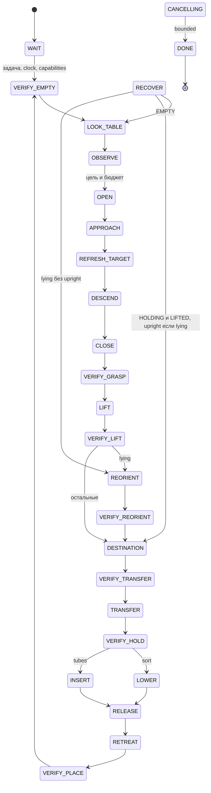

# Спецификация исполнения миссии 049

## Источники и границы

Требования: соседний репозиторий организаторов, `hackathon/docs/{TASKS,SCORING,INTERFACES}.md`,
`config/{tasks,pools,lab}.yaml`. Пул 4: figure/dish/box; sort2 использует первые две категории,
но назначение ящиков всегда берётся из TaskSpec.categories. Дополнительный sort2 использует пул 6
(electronics/box). Лимиты: sort2 270, sort3 405, tubes easy 240, standard 540, color/lying 360 секунд.
Баллы +10 за правильное конечное размещение, −10 за чужой контейнер, пол или взятый и оставленный объект,
0 за нетронутый. Зачёт пробирок и пула 6 требует положительной суммы основной сортировки.

Записанные ответы организаторов: `ANALYSIS.md §8`: «тронут» означает поднят; смещение без подъёма на столе
не штрафуется; время начинается с публикации задачи, включая запуск решения. Это записанные ответы,
не независимо проверенный код судьи. Доступный `objects.evaluate` проверяет финальную геометрию ящиков,
`lab.evaluate` — положение дна у гнезда и наклон <20°. Публичный код не подтверждает реализацию всей
истории штрафов или финального таймера. Локальный done сам не останавливает обычный dev-прогон.

Runtime использует только разрешённые ROS наблюдения и описание задачи. Никакого состояния физики,
внутренних поз или отладочного результата проверки. Оценка FSM не является официальным счётом.

Реализуется чистая функция `transition(context, event) -> context, effects`, один владелец очереди,
одна операция на весь робот. Иерархия: lifecycle → общий цикл предмета → фазы навыка.
Варианты определяют маршрутизацию и необходимые capabilities, а не копируют цикл.
Детекция, IK, контактный контроллер, вставка и переориентация не входят в эту работу.
Реальный адаптер не рекламирует отсутствующие capabilities. Fake подтверждает только логику.

## Физическая модель и доказательства

`Hand`: EMPTY/HOLDING/UNKNOWN; история `Lift`: NEVER_LIFTED/LIFTED/UNKNOWN;
размещение: confirmed boolean отдельно от завершения операции. Начальное состояние руки UNKNOWN.
Доказательства типизированы, имеют simulation stamp, источник, object_id, destination и slot.
Только свежая положительная проверка EMPTY разрешает новый захват, HOLDING — подъём и перенос,
HOLDING + lifted — историю подъёма, EMPTY + placed + правильный destination/slot — размещение.
Успех action, закрытие/раскрытие пальцев, отсутствие предмета в кадре этого не доказывают.

Реальный датчиковый адаптер описан в `FSM_VALIDATION.md`: свежий устойчивый контакт противопоставленных
пальцев, TF подъёма, именная RGB-D детекция после отхода. `Hand.object_detected` не используется.
Пороги являются инженерными эвристиками; физическая калибровка не выполнена. Для пробирок verifier отсутствует.
Срок свежести 2 s, таймаут операции 20 s, резерв 10 s, оценка цикла 40 s.
Wall watchdog 15 s, cancel 5 s. Остановка подтверждается новым окном измерений после terminal результата.

После спуска/контакта наблюдение сцены инвалидируется. План подъёма может сохраняться как заранее
построенная команда навыка, но не как новое наблюдение объекта. Место назначения наблюдается заново
после подъёма. История по имени распознанного объекта сохраняется; track_id существующего интерфейса
гарантирован только до движения. После контакта анонимный track не переиспользуется для новой попытки:
без повторной идентификации миссия завершается. Позиционные ключи не используются.

## Время, события, отмена

Тик содержит simulation time (None до первого clock) и monotonic wall time. Бюджет и таймауты
операций считают только simulation time; wall используется для watchdog. Точной метки публикации
задачи нет. По записанному ответу организаторов симулятор между раскладками не перезапускается:
deadline = первый simulation timestamp мозга + time_limit, reserve=10 s покрывает запуск и завершение.
Ожидание TaskSpec не обновляет начало бюджета. Нет clock/clock стоит → watchdog,
скачок назад → завершение; новый epoch не продолжает старую миссию.

Приоритет обработки: DONE поглощает события; clock/reset/deadline и CANCEL/ERROR прекращают работу;
затем lifecycle отмены; затем результат текущего operation_id; затем обычные переходы.
Владелец перед каждым событием обрабатывает свежий tick. Среди уже поставленных событий CANCEL/ERROR
имеют приоритет. Неизвестное событие, дубликат, неактуальный id — no-op с записью журнала.

Операция создаётся ровно один раз при входе. ACCEPTED не завершает её. REJECTED освобождает ресурс,
SEND_ERROR не гарантирует отсутствие исполнения и запускает отмену. Таймаут не освобождает ресурс.
CANCELLING ждёт ACK и терминальный RESULT; stop_confirmed требуется отдельно. Отказ/нет ACK,
терминальный исход без остановки или cancel watchdog → DONE с blocked=True. Новых команд нет.
Даже подтверждённая отмена завершает миссию; автоматического продолжения после таймаута нет.
Поздний принятый goal адаптер отменяет даже после завершения FSM. Успех cancel RPC не является
подтверждением физической остановки. Текущий motion не поддерживает подтверждённую остановку:
brain сохраняет блокировку и завершает миссию, не обещая физической остановки.

Завершение не возвращает руки/корпус домой. Оно запрещает команды, ограниченно отменяет активную,
сохраняет reason/hand/history/blocked и выдаёт эффект DONE. Публикация повторяется адаптером 3 раза с интервалом 0.2 wall s (fallback 10×0.5 s),
ошибки одной попытки не мешают остальным. DONE означает конец управления, не успех задания.

## Состояния

Все операции ждут ACCEPTED/RESULT/REJECTED/SEND_ERROR; timeout 20 sim s или wall watchdog.
Любое активное состояние отменяется через CANCELLING; локальное состояние без операции — сразу DONE.
Все проверки используют данные не старше 2 sim s и не старше входа в проверку, кроме сцены до контакта.

| Состояние | Назначение / предусловия / данные | Вход | Подтверждение и нормальный выход | Ошибка / восстановление |
|---|---|---|---|---|
| WAIT | задача и clock; рука UNKNOWN | нет команды | START сохраняет задачу; tick → CHECK | startup watchdog → DONE |
| CHECK | известная задача, лимит, capabilities | локальная проверка | необходимые навыки есть → VERIFY_EMPTY | unsupported/unavailable → DONE |
| VERIFY_EMPTY | перед новой попыткой | запрос доказательства | свежий EMPTY → LOOK_TABLE | UNKNOWN/HOLDING → DONE |
| LOOK_TABLE | рука EMPTY | MoveJoints головы/корпуса к столу | успех → OBSERVE | ошибка → bounded recovery / stop |
| OBSERVE | рука EMPTY | perception table | свежая сцена pelvis → выбор | ошибки/устаревание: ограниченный повтор, затем DONE |
| SELECT (локально) | назначение, уверенность, свободное гнездо, бюджет | выбор + счётчик попыток | цель → OPEN | нет кандидатов/времени → DONE |
| OPEN | EMPTY, выбран предмет | открыть кисть | success → APPROACH | ограниченный recovery |
| APPROACH | актуальная сцена | предзахват | success → DESCEND | unreachable/rejected → recovery |
| DESCEND | актуальная сцена до начала контакта | спуск, инвалидировать сцену | success → CLOSE | рука UNKNOWN → recovery |
| CLOSE | цель и контактный план | закрытие | success → VERIFY_GRASP | UNKNOWN → recovery |
| VERIFY_GRASP | после закрытия | запрос доказательства | HOLDING → LIFT | EMPTY → recovery; UNKNOWN → DONE |
| LIFT | подтверждённый HOLDING | подъём; lift history UNKNOWN до проверки | success → VERIFY_LIFT | recovery с проверкой удержания |
| VERIFY_LIFT | после подъёма | запрос доказательства | HOLDING + lifted → DESTINATION или REORIENT | EMPTY → recovery; UNKNOWN → DONE |
| REORIENT | tubes lying, подтверждённый подъём | составной навык upright | success → VERIFY_REORIENT | recovery; навык недоступен → пропуск до захвата |
| VERIFY_REORIENT | после переориентации | запрос доказательства | HOLDING + upright → DESTINATION | нет подтверждения → DONE |
| DESTINATION | HOLDING | свежая сцена контейнеров (hood для tubes) | назначенный контейнер/свободный слот → VERIFY_TRANSFER | ограниченный recovery |
| VERIFY_TRANSFER | после осмотра назначения | запрос доказательства | свежий HOLDING и свежая цель → TRANSFER | EMPTY → recovery; UNKNOWN → DONE |
| TRANSFER | HOLDING и актуальная цель | перенос (включая поворот для tubes) | success → VERIFY_HOLD | recovery; не раскрывать автоматически |
| VERIFY_HOLD | после переноса | запрос доказательства | HOLDING → LOWER/INSERT | EMPTY → recovery; UNKNOWN → DONE |
| LOWER | sort, HOLDING | спуск в ящик | success → RELEASE | recovery |
| INSERT | tubes, HOLDING, свободный слот | составной навык вставки | success → RELEASE | recovery |
| RELEASE | у назначения | открыть, hand UNKNOWN | success → VERIFY_PLACE | recovery, не объявлять EMPTY |
| VERIFY_PLACE | после раскрытия | запрос доказательства | EMPTY + placed + destination/slot → RETREAT | иначе DONE placement_unconfirmed |
| RETREAT | подтверждённое размещение | отход | success → VERIFY_EMPTY | DONE retreat_failed, placement сохраняется |
| RECOVER | терминальная ошибка навыка | проверить руку | EMPTY → новый осмотр; HOLDING+LIFTED → REORIENT для lying без upright, иначе новое назначение | UNKNOWN, лимит, анонимная цель после контакта → DONE |
| CANCELLING | есть активная операция | один cancel | ACK+terminal+stopped → DONE | отказ/no ack/no stop → blocked DONE; 5 wall s |
| DONE | reason отдельно от успеха | эффект publish done | поглощает всё | никаких движений |

## Таблица переходов

Обозначения: ACTIVE — любое состояние с operation; id=current; fresh — timestamp в текущем epoch,
не раньше входа в проверку и не старше freshness (для Scene — не раньше последнего LOOK_TABLE/контакта, а не запроса сервиса); retry — общий и пообъектный лимит не исчерпаны.
Общие строки имеют приоритет над строками отдельных навыков.

| Текущее состояние | Событие | Guard | Изменение контекста | Побочный эффект | Следующее состояние |
|---|---|---|---|---|---|
| DONE | любое | всегда | нет | нет | DONE |
| любое кроме DONE | TICK | clock назад / watchdog / deadline | reason | cancel или done | CANCELLING / DONE |
| любое кроме DONE | CONNECTION_LOST | ROS контекст утрачен | blocked если active, reason | done | DONE |
| активное, hand=HOLDING | SENSOR | свежий EMPTY или неизвестное/устаревшее доказательство | hand=EMPTY/UNKNOWN, reason | cancel | CANCELLING |
| любое кроме DONE | CANCEL / ERROR | всегда | reason | cancel или done | CANCELLING / DONE |
| WAIT | START | первая задача | spec, capabilities | нет | WAIT |
| WAIT | TICK | spec, clock, хватает бюджета | deadline | проверка capabilities | CHECK → VERIFY_EMPTY / DONE |
| ACTIVE | TICK | operation timeout | reason=operation_timeout | cancel | CANCELLING |
| ACTIVE | ACCEPTED | id=current | accepted=True | нет | то же |
| ACTIVE | SEND_ERROR | id=current | reason=send_error | cancel | CANCELLING |
| ACTIVE | RESULT | id=current, failure движения без stopped | reason | cancel | CANCELLING |
| ACTIVE | RESULT / REJECTED | id=current, success / rejected / failure со stopped или read-only | снять active, сохранить исход | следующий эффект | по строкам ниже |
| CANCELLING | ACCEPTED | id=current | accepted=True | нет: адаптер отменит поздний goal | CANCELLING |
| CANCELLING | CANCEL_ACK | id=current, accepted | ack=True | нет | CANCELLING или DONE при terminal+stop |
| CANCELLING | CANCEL_ACK | id=current, отказ | blocked=True | done | DONE |
| CANCELLING | RESULT / REJECTED | id=current | terminal=True, stop_confirmed | нет / done при ack | CANCELLING / DONE |
| CANCELLING | TICK | cancel wall timeout | blocked=True | done | DONE |
| VERIFY_EMPTY | RESULT | fresh EMPTY | hand=EMPTY | look | LOOK_TABLE |
| LOOK_TABLE | RESULT | success | нижняя граница времени кадра | perceive | OBSERVE |
| OBSERVE | RESULT | fresh scene, кандидат, время | target, attempts++, destination | open | OPEN |
| OBSERVE | RESULT | пусто/лимит попыток/мало времени | reason | done | DONE |
| OBSERVE | RESULT | failure/stale, retry | retries++ | look | LOOK_TABLE |
| OPEN | RESULT | success | нет | approach | APPROACH |
| APPROACH | RESULT | success | инвалидировать старый кадр | perceive target | REFRESH_TARGET |
| REFRESH_TARGET | RESULT | свежий прежний target, смещение ≤2 cm | новая сцена | descend | DESCEND |
| DESCEND | ACCEPTED / SEND_ERROR / RESULT | команда могла исполниться | invalidate scene, hand UNKNOWN, contacted | обработка исхода | DESCEND / CANCELLING / CLOSE |
| CLOSE | RESULT | success | нет | verify | VERIFY_GRASP |
| VERIFY_GRASP | RESULT | fresh HOLDING | hand=HOLDING | lift; history UNKNOWN после принятия/неопределённой отправки | LIFT |
| LIFT | RESULT | success | нет | verify | VERIFY_LIFT |
| VERIFY_LIFT | RESULT | fresh HOLDING + lifted | history LIFTED | reorient / observe destination | REORIENT / DESTINATION |
| REORIENT | RESULT | success | нет | verify | VERIFY_REORIENT |
| VERIFY_REORIENT | RESULT | fresh HOLDING + upright | hand=HOLDING | perceive destination | DESTINATION |
| DESTINATION | RESULT | fresh target container + free slot | destination, slot | verify | VERIFY_TRANSFER |
| VERIFY_TRANSFER | RESULT | fresh HOLDING + fresh destination scene | hand=HOLDING | transfer | TRANSFER |
| VERIFY_TRANSFER | RESULT | HOLDING, но scene устарела | retries++ | verify recovery | RECOVER |
| TRANSFER | RESULT | success | нет | verify | VERIFY_HOLD |
| VERIFY_HOLD | RESULT | fresh HOLDING | hand=HOLDING | lower / insert | LOWER / INSERT |
| LOWER / INSERT | RESULT | success | hand=UNKNOWN | release | RELEASE |
| RELEASE | RESULT | success | нет | retreat | RETREAT |
| VERIFY_PLACE | RESULT | fresh EMPTY + placed + matching target | placed=True, hand=EMPTY | verify empty | VERIFY_EMPTY |
| RETREAT | RESULT | success | нет | verify placement | VERIFY_PLACE |
| навыки | RESULT / REJECTED | failure, retry | retries++, scene invalid | verify | RECOVER |
| RECOVER | RESULT | fresh EMPTY, identity usable | hand=EMPTY | look | LOOK_TABLE |
| RECOVER | RESULT | fresh HOLDING, history LIFTED, lying без подтверждения upright | hand=HOLDING | reorient | REORIENT |
| RECOVER | RESULT | fresh HOLDING, history LIFTED, остальные | hand=HOLDING | perceive destination | DESTINATION |
| проверки | RESULT | unknown/stale/invalid evidence | hand=UNKNOWN, reason | done | DONE |
| любое | неизвестное / старый id / дубликат | не подходит выше | нет | нет | то же |

## Стратегии

sort2/sort3: categories[category] → обнаруженный tray. Не связывать цвет с категорией в коде.
tubes easy: any_slot, standard/lying: by_type, color: by_cap_color. Только racks с where=hood.
Для tubes слот выбирается из свежих slots/slot_occupied; занятые и уже использованные слоты исключаются.
Lying добавляет REORIENT и VERIFY_REORIENT. Навыки вставки/переориентации — отдельные capabilities.
После подъёма бюджет нового цикла не проверяется: приоритет доставка; жёсткий deadline действует всегда.
Повторы ограничены на миссию и объект, новые track ID не обходят глобальный лимит.

Общие дуги из каждого состояния (ошибка → RECOVER; cancel/timeout → CANCELLING; stop → DONE)
определены таблицей, чтобы диаграмма не скрывала приоритеты.

## Соответствие реализации и границы проверки

CHECK и SELECT — локальные ветви reducer, не отдельные значения Enum и не длительные состояния.
Операционные ошибки read-only/REJECTED допускают recovery; ошибка движения без stopped не допускает
recovery и сначала запускает отмену. Потеря соединения завершает ожидание с blocked, если есть active.
ROS callbacks не создают физические доказательства автоматически. SENSOR — контракт для будущего
потокового verifier; адаптер контролирует непрерывность контакта и свежесть состояния кисти при переносе.
VERIFY_TRANSFER добавлен, чтобы осмотр назначения не позволял использовать старую оценку удержания.

Общий лимит recovery — 6; попыток на объект — 2. Исчерпанные объекты отфильтровываются;
нет оставшихся допустимых кандидатов → candidates_exhausted, а не «все успешно». Ошибка RETREAT
сохраняет подтверждённую укладку и завершает миссию. Нет безусловного cleanup-движения.

Проверки и ограничения перечислены в `FSM_VALIDATION.md`. Существующие ROS интерфейсы не менялись.

## Изменения после review #6 (2026-11-08)

Интегрирован main b69da20. Sorting capabilities включают реализованный датчиковый verifier.
Ошибки движения ждут свежих устойчивых измерений после terminal action; подтверждённый покой
разрешает RECOVER, отсутствие подтверждения — только отмену/завершение. Motion принимает отмену,
прекращает выдачу траектории и заменяет цели измеренным удержанием без раскрытия кисти.
При HOLDING и неподтверждённом подъёме разрешены максимум max_attempts команд LIFT.
REFRESH_TARGET повторно наблюдает цель после подхода, проверяя прежнюю идентичность и смещение.
RELEASE → RETREAT → VERIFY_PLACE позволяет убрать кисть из кадра до подтверждения размещения.
Только после VERIFY_PLACE история помечается placed; неудачный отход не объявляет укладку.
Done: 3×0.2 s при штатном завершении, 10×0.5 s только в fallback.

PR остаётся draft до физического прогона: middleware-тесты не подтверждают успешный захват,
качество perception, калибровку контакта или конечный балл. Tube-навыки по-прежнему отсутствуют.
