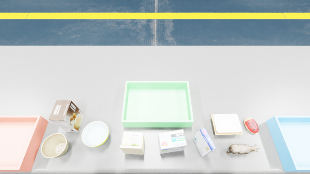

# Первый свежий Perceive после LOOK_TABLE: live Sort3/pool 4

8 ноября 2026 (МСК). Итоговая серия: **6/6 первых ответов прошли**.
Runtime-код: `ebaeb13406257208f19f654291f6fab40357edb1`.
Это живой официальный Sort3/pool 4 с физическим исполнением LOOK_TABLE,
без захватов. Источники решения: ROS RGB-D/CameraInfo/TF, суставы и штатные
метаданные задачи; GT, USD poses, physics logs, seed/layout и debug setters
решению не передавались.

## Фактический результат

Перед каждым LOOK_TABLE голова переводилась в другое положение. Затем
штатный MoveJoints возвращал голову/корпус в
`head_pitch=0.4, head_yaw=0, body_yaw=0`. Сразу после успешного action result
клиент делал **один** `/perception/perceive`, без повторения RPC до успеха.
Проверялось: success, stamp не раньше запроса и завершения LOOK_TABLE,
возраст до 1 sim s, наблюдаемые лотки/объекты и хотя бы один необрезанный
кандидат с confidence ≥0.6 в назначенный наблюдаемый лоток.

| Первый RPC после LOOK_TABLE | Wall RPC, с | Возраст, sim s | Лотков | Подходящих кандидатов |
|---|---:|---:|---:|---:|
| 1 | 0,523 | 0,390 | 1 | 3 |
| 2 | 0,430 | 0,330 | 1 | 3 |
| 3 | 0,324 | 0,230 | 3 | 8 |
| 4 | 0,378 | 0,280 | 3 | 7 |
| 5 | 0,497 | 0,380 | 1 | 3 |
| 6 | 0,593 | 0,450 | 3 | 7 |

Медиана RPC **0,463 с**. Во всех шести ответах девять названных кластеров.
Это не GT-проверка правильности их идентичностей/поз. Все три лотка не
гарантированы на каждом взгляде: боковые лотки обрезаются кадром. В каждом
ответе оставались реальные кандидаты для текущего brain.
Потолок wall latency 0,5 с **не пройден во всех вызовах**; свежесть прошла.
Шесть взглядов одной раскладки не являются оценкой стабильности на новых
раскладках или успешности сортировки.

[Сырые ответы](live_20261108/live_result.json),
[perception stage timings](live_20261108/perception.log),
[motion node log](live_20261108/motion.log),
[метаданные задачи без координат](live_20261108/task_metadata.json),
[сводка и hashes](live_20261108/summary.json).

Контрольный кадр после серии, отдельно от RPC-экспозиций в таблице:

Сохранены также [голова RGB-D/K/TF](live_20261108/cam_head.npz) и
[торс RGB-D/K/TF](live_20261108/cam_torso.npz). Это сенсорные данные и TF камер,
без объектных GT-поз. Эти записи не использовались онлайн как раскладка.

## Что исправлено

- Вместо отдельных «последних сообщений» используется один общий bounded
  буфер целых экспозиций для baseline и model worker. RGB, depth и оба
  CameraInfo принадлежат одному stamp/frame. Одна подписка на поток сохранена.
- Живой тест показал, что image может прийти раньше соответствующего `/clock`.
  Выбирается экспозиция `request_stamp <= exposure_stamp <= now`; предыдущие
  целые экспозиции сохраняются, будущая не вытесняет подходящий кадр.
  Короткий polling учитывает приход clock без нового image callback.
- `perceive_frame_wait_s` по умолчанию **0,75 wall s**, ограничен 0..1 s.
  Ожидание отпускает input lock и даёт callbacks доставить новый кадр.
  Возраст источника по sim time остаётся **1 s**; TTL не увеличен. Время ROS
  читается вне input lock, чтобы не инвертировать порядок с clock reset.
- Последовательные ожидания TF рук до 0,2 s на руку заменены неблокирующими
  exact-stamp lookup. Отсутствующий TF оставляет ту же штатную геометрическую
  fallback-фильтрацию, без придуманной позы руки. Camera TF ограничен 0,05 s,
  worker TF — 0,03 s вне input lock.
- Диагностика и обычный отчёт Perceive отправляются в отдельную bounded
  очередь. RPC не ждёт вывода логов. Записываются frame wait, cloud/TF,
  arm TF, cluster и classify/trays stages; долгие inference callbacks в
  штатный сервис не добавлены.
- Недостающие лотки можно измерить по connected plastic color/depth и
  наблюдаемой плоскости, без ожидания YOLO. Применяется тот же rectangle/
  three-wall fit. Две стенки не считаются достаточным основанием. Сначала
  сохраняются model openings и штатные whole-tray результаты; дорогой fit
  выполняется только для недостающих цветов/IDs.
- `serialized_images=true` принимает большие Image как XCDR1 bytes и
  декодирует metadata/payload без материализации pixel-массива в generated
  Image object. Pixel bytes сохраняются. CameraInfo и выходные ROS messages
  остаются штатными. Есть `serialized_images:=false` для типизированного
  приёма. Паритет проверен реальным Humble serializer, включая endian,
  padding и frame strings. Отдельный количественный A/B speedup этим отчётом
  не заявляется.

Первоначальные 1,36–1,40 с из ROS replay не являются чистым временем алгоритма:
Python-публикатор картинок находился в том же процессе, а отсутствующие TF рук
добавляли последовательные ожидания. Чистая кластеризация того сохранённого
кадра отдельно занимала 37–39 мс. В ранних live попытках дополнительно были
future-stamp отказы, пустые первые кадры и один длинный expired ответ. Они
сохранены, не включены в успешную серию и не выданы за live baseline speedup.

## Версии, изоляция и воспроизведение

- Официальный simulator source:
  `08247fc6ac9ed9f194d7bd2d1bfde434ea9cd578`, существующий native Isaac Sim 5
  runtime из `nssr-dev:6057b5989a06`, image digest
  `sha256:b3cfb38b84c65a7947c7f6475010b08ac9c61dd9bd667afe86bfbc5ae2933121`.
  Sim6 compatibility/shim в этом опыте не использовался.
- `HACK_TASK=sort3`, `HACK_POOL=4`, render interval 3, 640×360,
  `--headless --device cpu --step_hz 100`, RTX renderer на RTX PRO 6000.
  `HACK_PLUGIN`, `HACK_LAYOUT`, `HACK_OBJECTS`, `HACK_SEED` не задавались;
  официальный sampler создавал новую сцену. Код решения seed не получал.
- Отдельные собственные simulator/solution containers с общей **private
  network и private shareable IPC**, domain 209. Host network/IPC не нужны.
  Только simulator монтировал официальный repo/assets. Solution видел
  собственный source, проверенный model bundle и собственные outputs;
  simulator/USD/physics logs не монтировались в solution.
- CPU affinity: simulator 0–11, solution 12–17; limits 12/6 CPU и 24/8 GiB.
  Native tasking threads ограничены восемью. NumPy 1.26.4,
  OPENBLAS_NUM_THREADS=1, OMP_NUM_THREADS=2 в solution.
- Model bundle включён, worker CPU ready, `rgbd_on_demand=true`; в финальной
  acceptance-серии 6D не запрашивалась. Motion node `planner=ik`: выполнялся
  только штатный MoveJoints для головы/корпуса; cuRobo не загружался.

[Точный probe](live_20261108/live_probe.py),
[boot simulator](live_20261108/boot_sim.sh),
[start solution](live_20261108/start_solution.sh),
[DDS profile](live_20261108/fastdds_hack.xml),
[source hashes](live_20261108/source-live-manifest.json),
[runtime receipt](live_20261108/runtime-receipt.txt).

В подготовленной собственной копии, с ROS/setup/model bundle из основного
[контракта](ROS_MODEL_POSES.md), запускаются только perception и motion,
затем `live_probe.py`. Для финальной серии `NSSR_DURING_6D=0` (default),
`NSSR_PROBE_REPEATS=6`. Probe проверяет единственный perception node после
истечения stale DDS discovery entries. Он не вызывает grasp, task/check,
результат соревнования или debug services. Для контейнеров нужны private
shared network **и** `--ipc shareable` у simulator / `--ipc container:...`
у solution: один network namespace без общего SHM не проверяет штатный DDS.

**49 тестов** на настоящих ROS imports, пять пакетов colcon build и launch
`--show-args` прошли. [Полный финальный log](live_20261108/unit-published.log).
На Mac 45 прошли, четыре ROS-only теста пропущены; Linux выполнил все 49.
check_rules, diff-check и Python syntax проверены отдельно.

Оба собственных live контейнера остановлены, running=false, PID=0, exit=0;
[stop receipt](live_20261108/stop-receipt.txt). Исходный GR00T-процесс сохранился
с тем же PID и 6942 MiB. Чужие контейнеры/задания не останавливались и не
менялись. На Slurm ничего не запускалось; остановленные grasp-кампании не
возобновлялись.

Все результаты фактически возвращены на Mac:
`outputs/pr5_perceive_latency_20261107/`. Полный финальный архив SHA256:
`0be60ffadb11e0c6c9f65af03d79d9ad7d3c49ff8d498b1e5d46a9a08da66abd`.
Собственная удалённая копия:
`nssr-rtx6000:/home/spiridonov/vlad/junk/nssr-uwt-20261030/pr5-perceive-latency-20261107`.

## Что остаётся открытым

Первый свежий ответ live Sort3/pool 4 подтверждён в указанном объёме.
Серия Perceive при **активном 6D** не завершена: отдельные попытки остановились
на gate `no real pose submission observed`; один частичный успешный вызов не
закрывает SLA. Неполные/диагностические серии сохранены отдельно. В частности,
профилировочная серия не считается acceptance; окончательная серия была
без профилировщика с единственным perception server.

Также не закрыты универсальный wall budget 0,5 s, свежий fallback после
crash/restart worker, память рядом с cuRobo, live occlusion рукой,
official `solution.sh`, качество/допустимость offline train bundle, grasp и
официальная квалификация. Успех этого smoke не является успехом сортировки
или измерением точности 6D на GT.
